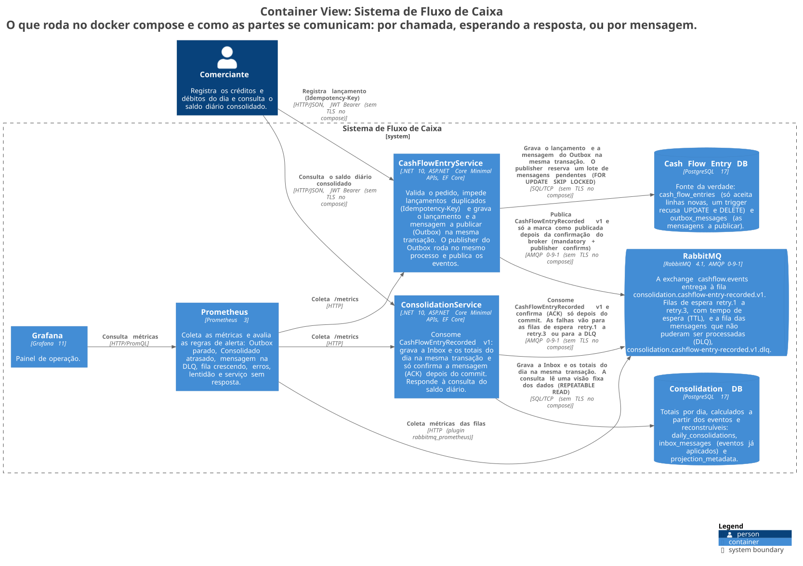

# Desafio de Arquitetura de Soluções — Fluxo de Caixa

Um comerciante registra lançamentos — créditos (dinheiro que entra) e débitos (dinheiro que
sai) — e consulta o saldo consolidado de cada dia. Este repositório entrega a arquitetura dessa
solução (requisitos, domínios, decisões, Arquitetura Alvo, custos) e uma implementação que roda
na sua máquina com Docker Compose: dois serviços em .NET 10, PostgreSQL, RabbitMQ, Prometheus e
Grafana, com testes automatizados e testes de carga.

O requisito que dá forma a tudo está no PDF do desafio: **o registro de lançamentos não pode
ficar indisponível se o consolidado diário cair**. Por isso, registrar e consultar ficam em dois
serviços separados, cada um com o próprio banco, e eles só conversam por mensagens.

| Se você quer… | Vá para |
|---|---|
| Entender a solução e as decisões em 5 minutos | [1. Arquitetura](#1-arquitetura) e [2. Como o desafio foi atendido](#2-como-o-desafio-foi-atendido) |
| Subir o ambiente | [4. Executar localmente](#4-executar-localmente) |
| Testar pelo navegador | [6. Testar pelo Swagger](#6-testar-pelo-swagger) |
| Testar pela coleção do Postman | [7. Testar pelo Postman](#7-testar-pelo-postman) |
| Ver o registro funcionando com o Consolidado fora do ar | [9. Provar que Lançamentos não depende do Consolidado](#9-provar-que-lançamentos-não-depende-do-consolidado-nfr-a) |
| Rodar os testes automatizados e de carga | [10. Testes automatizados e de carga](#10-testes-automatizados-e-de-carga) |

## Sumário

1. [Arquitetura](#1-arquitetura)
2. [Como o desafio foi atendido](#2-como-o-desafio-foi-atendido)
3. [Pré-requisitos](#3-pré-requisitos)
4. [Executar localmente](#4-executar-localmente)
5. [Token de acesso](#5-token-de-acesso)
6. [Testar pelo Swagger](#6-testar-pelo-swagger)
7. [Testar pelo Postman](#7-testar-pelo-postman)
8. [Testar pelo terminal e conferir no banco](#8-testar-pelo-terminal-e-conferir-no-banco)
9. [Provar que Lançamentos não depende do Consolidado (NFR-A)](#9-provar-que-lançamentos-não-depende-do-consolidado-nfr-a)
10. [Testes automatizados e de carga](#10-testes-automatizados-e-de-carga)
11. [Operação](#11-operação)
12. [Problemas comuns](#12-problemas-comuns)
13. [Limitações conhecidas e evoluções futuras](#13-limitações-conhecidas-e-evoluções-futuras)
14. [Documentação e estrutura do repositório](#14-documentação-e-estrutura-do-repositório)

## 1. Arquitetura

### Os dois serviços

- **Lançamentos** (`LaunchService`, porta 5101) registra cada crédito ou débito. A tabela
  `launches` é a fonte da verdade: o registro oficial do qual os totais são calculados. Ela só
  recebe linhas novas; um gatilho (trigger) no banco impede alterar ou apagar uma linha.
- **Consolidado** (`ConsolidationService`, porta 5102) guarda os totais de cada dia e responde à
  consulta de saldo. É um dado derivado: pode ficar alguns segundos atrás de Lançamentos e pode
  ser reconstruído a partir deles.

O diagrama abaixo segue o modelo C4 (forma padronizada de desenhar arquitetura em níveis de
zoom), no nível C2: cada aplicação, banco e broker (servidor de mensagens, aqui o RabbitMQ) que
roda no `docker compose`, e como eles se comunicam.



### O caminho de um lançamento

Os passos 1 a 4 acontecem dentro da requisição do cliente; os passos 5 a 8, depois, em segundo
plano.

1. O cliente envia `POST /api/v1/launches` com o cabeçalho `Idempotency-Key`, um identificador
   que ele escolhe para aquela operação. Se a resposta se perder e ele reenviar a mesma chave com
   o mesmo corpo, recebe o lançamento original, sem criar um segundo.
2. Lançamentos valida o corpo (valor positivo em centavos, natureza `Credit` ou `Debit`) e a
   chave.
3. Lançamentos grava, numa única transação do banco, o lançamento e a mensagem a publicar, na
   tabela Outbox. Ou os dois são gravados, ou nenhum é.
4. O cliente recebe `201 Created`. A resposta não espera o RabbitMQ nem o Consolidado.
5. Uma tarefa em segundo plano de Lançamentos (o publicador do Outbox) envia as mensagens
   pendentes ao RabbitMQ. Ela só marca uma mensagem como enviada quando o RabbitMQ confirma que a
   guardou numa fila.
6. O RabbitMQ entrega a mensagem ao consumidor do Consolidado.
7. O consumidor grava, numa única transação, o identificador do evento na tabela Inbox (que
   impede somar o mesmo evento duas vezes) e o valor nos totais do dia. Só depois confirma o
   recebimento ao RabbitMQ. Se cair antes disso, o RabbitMQ entrega a mensagem de novo e a Inbox
   descarta a cópia.
8. `GET /api/v1/consolidation` lê os totais por dia. A resposta informa até quando os dados estão
   atualizados (`asOfUtc` e `lastAppliedLagSeconds`).

Quando o processamento de uma mensagem falha, o consumidor tenta de novo depois de 5 s, 30 s e
120 s. Uma falha temporária (por exemplo, o banco do Consolidado fora do ar) continua tentando
enquanto durar; uma mensagem inválida ou uma falha inesperada vai para a DLQ (Dead Letter Queue,
fila das mensagens que não puderam ser processadas), que dispara um alerta. Detalhes em
[`docs/05-aspectos-transversais.md` §2](docs/05-aspectos-transversais.md#2-resiliência-e-recuperação).
Diagramas de sequência: [registro, Outbox e consumo](docs/diagrams/05-sequence-register-outbox.md)
e [indisponibilidade e recuperação](docs/diagrams/07-sequence-outage-recovery.md).

### Decisões principais e o que cada uma custa

Cada decisão está registrada num ADR (Architecture Decision Record, registro de decisão de
arquitetura), com as alternativas descartadas.

| Decisão | Por quê | O que custa (trade-off) | ADR |
|---|---|---|---|
| Dois serviços independentes, sem código nem banco compartilhados | Lançamentos precisa continuar no ar com o Consolidado fora (NFR-A) | Mais peças para operar; o formato do evento precisa continuar compatível entre os dois | [ADR-001](docs/adr/ADR-001-estilo-arquitetural.md) |
| Comunicação só por mensagens, pelo RabbitMQ | Nenhuma chamada direta: a falha de um lado não derruba o outro | Consulta alguns segundos atrás; é preciso monitorar fila, atraso e DLQ | [ADR-002](docs/adr/ADR-002-integracao-assincrona.md) |
| Outbox na mesma transação do lançamento | Nenhum lançamento confirmado fica sem a mensagem, mesmo com o RabbitMQ fora (RPO, Recovery Point Objective, perda máxima de dados, igual a zero) | A mesma mensagem pode ser publicada mais de uma vez; a tabela cresce até existir uma limpeza | [ADR-003](docs/adr/ADR-003-transactional-outbox.md) |
| Idempotência na entrada (`Idempotency-Key`) e no consumo (Inbox) | Nem uma requisição repetida nem uma mensagem entregue de novo somam um valor duas vezes | Guardar chaves e identificadores de evento enquanto puder haver repetição | [ADR-004](docs/adr/ADR-004-processamento-idempotente.md) |
| Consolidado como tabela de totais por dia, atualizada por eventos (consistência eventual) | Consulta rápida, sem recalcular o histórico; totais podem ser reconstruídos | O saldo pode aparecer alguns segundos depois do registro | [ADR-005](docs/adr/ADR-005-eventual-consistency.md) |
| Um banco por serviço, com um usuário de banco que só acessa o próprio banco | A barreira é o banco, não só a disciplina do código | Uma instalação atende um único comerciante | [ADR-006](docs/adr/ADR-006-isolamento-de-dados.md) |
| API e trabalho em segundo plano no mesmo processo, em cada serviço | Metade dos programas para implantar, sem perder o isolamento entre os serviços | Um defeito no consumidor pode afetar a API de consulta do mesmo serviço | [ADR-011](docs/adr/ADR-011-topologia-de-processos.md) |

As demais decisões — provedor de identidade externo, PostgreSQL, .NET com Minimal APIs,
observabilidade, borda com API Gateway e WAF (Web Application Firewall, filtro que bloqueia
ataques conhecidos) — estão no [índice de ADRs](docs/adr/README.md).

### Como lemos o requisito de pico (50 requisições por segundo, até 5% de perda)

O PDF não define "perda". Lemos "perda" como requisição que falha (erro, tempo esgotado), nunca
como lançamento perdido: perder um movimento financeiro não é aceitável (premissa A-004). E
"o consolidado recebe 50 requisições por segundo" foi testado nas duas leituras possíveis: 50
consultas por segundo ao Consolidado e 50 lançamentos por segundo chegando a ele por eventos.
Detalhes em [`docs/01-requisitos-e-assumptions.md`](docs/01-requisitos-e-assumptions.md#nota-o-que-quer-dizer-o-consolidado-recebe-50-requisições-por-segundo-nfr-002);
resultados em [10. Testes automatizados e de carga](#10-testes-automatizados-e-de-carga).

### Arquitetura Alvo (produção)

O que roda no `docker compose` é a entrega local. A Arquitetura Alvo acrescenta API Gateway com
WAF, provedor de identidade real, cópias redundantes de cada peça, RPO e RTO (Recovery Time
Objective, tempo máximo para voltar a funcionar) definidos e a arquitetura de transição.
Diagramas [C2 — Alvo](docs/diagrams/svg/C2-Alvo.svg) e
[Deployment — Alvo](docs/diagrams/svg/Deployment-Alvo.svg); texto em
[`docs/06-arquitetura-alvo.md`](docs/06-arquitetura-alvo.md). A tabela
[§11 do mesmo documento](docs/06-arquitetura-alvo.md#11-implementado-nesta-entrega--arquitetura-alvo)
separa o que foi implementado do que só foi desenhado.

## 2. Como o desafio foi atendido

O PDF não numera os itens; os códigos abaixo são nossos. O texto original de cada item e a
evidência completa estão em [`docs/09-rastreabilidade.md`](docs/09-rastreabilidade.md).

| Item do PDF | Onde está atendido |
|---|---|
| **BR-01** Serviço de controle de lançamentos | `src/LaunchService/` · [`RecordLaunchTests.cs`](tests/LaunchService.IntegrationTests/RecordLaunchTests.cs) |
| **BR-02** Consolidado diário (saldo de cada dia) | `src/ConsolidationService/`, resposta com `days[]` · [`GetConsolidationTests.cs`](tests/ConsolidationService.IntegrationTests/GetConsolidationTests.cs) |
| **NFR-A** Lançamentos não fica indisponível se o Consolidado cair | [Seção 9](#9-provar-que-lançamentos-não-depende-do-consolidado-nfr-a) · [`scripts/e2e/smoke.sh`](scripts/e2e/smoke.sh) · [`BrokerUnreachableTests.cs`](tests/LaunchService.IntegrationTests/BrokerUnreachableTests.cs) |
| **NFR-B/NFR-C** 50 requisições por segundo, até 5% de perda | [`docs/evidence/load/`](docs/evidence/load/) (0% de falha) |
| **MR-01** Domínios funcionais e capacidades de negócio | [`docs/02-capacidades-e-dominios.md`](docs/02-capacidades-e-dominios.md) |
| **MR-02** Requisitos funcionais e não funcionais refinados | [`docs/01-requisitos-e-assumptions.md`](docs/01-requisitos-e-assumptions.md) |
| **MR-03** Desenho completo da Arquitetura Alvo | [`docs/06-arquitetura-alvo.md`](docs/06-arquitetura-alvo.md) · [`docs/diagrams/`](docs/diagrams/README.md) |
| **MR-04** Justificativa de tecnologias e do tipo de arquitetura | [`docs/adr/`](docs/adr/README.md) (12 ADRs) |
| **MR-05** Linguagem que você domina | C# / .NET 10 ([`global.json`](global.json)) |
| **MR-06** Testes | 5 projetos de teste em `tests/`, teste ponta a ponta e de carga ([seção 10](#10-testes-automatizados-e-de-carga)) |
| **MR-07** README com como a aplicação funciona e como rodar localmente | Este arquivo |
| **MR-08** Repositório público no GitHub | Este repositório |
| **MR-09** Toda a documentação no repositório | [`docs/`](docs/) |
| **DF-01** Arquitetura de transição | [`docs/06-arquitetura-alvo.md` §10](docs/06-arquitetura-alvo.md#10-arquitetura-de-transição-df-01) |
| **DF-02** Estimativa de custos de infraestrutura e licenças | [`docs/08-custos.md`](docs/08-custos.md) |
| **DF-03** Monitoramento e observabilidade | Prometheus, Grafana e 9 regras de alerta em [`observability/`](observability/) · [ADR-010](docs/adr/ADR-010-observabilidade.md) |
| **DF-04** Critérios de segurança para consumo de serviços | [`docs/05-aspectos-transversais.md` §1](docs/05-aspectos-transversais.md#1-segurança-e-modelo-de-ameaças) · [`docs/06-arquitetura-alvo.md` §8](docs/06-arquitetura-alvo.md#8-segurança-na-arquitetura-alvo) |

**Fora do escopo desta entrega**, por não estarem no PDF: estorno dedicado, vários comerciantes
na mesma instalação, perfis de usuário, eliminação de duplicatas pelo identificador da transação
no sistema de origem (por exemplo, a maquininha de cartão) e um `audience` (o campo do token que
diz para qual API ele vale) por API. O motivo de cada um está em
[`docs/01-requisitos-e-assumptions.md` § "Fora do escopo desta entrega"](docs/01-requisitos-e-assumptions.md#fora-do-escopo-desta-entrega).

## 3. Pré-requisitos

| Ferramenta | Para quê | Obrigatória? |
|---|---|---|
| Docker com Docker Compose v2 (comando `docker compose`, não `docker-compose`) | Subir o ambiente | Sim |
| `curl` | Verificações rápidas e exemplos pelo terminal | Sim, para as seções 4, 8 e 9 |
| Python 3.8 ou mais novo, só com a biblioteca padrão | Gerar o token de acesso para o Swagger e o terminal; usado também pelos scripts | Sim, exceto se testar só pelo Postman |
| Postman | Rodar a coleção da [seção 7](#7-testar-pelo-postman) | Não |
| SDK (Software Development Kit) do .NET 10 | Rodar `dotnet test` fora do Docker. [`global.json`](global.json) fixa a versão `10.0.402` e aceita qualquer 10.0 igual ou mais nova | Só para a seção 10 |

As portas abaixo precisam estar livres no seu computador: `5101`, `5102`, `5433`, `5672`,
`15672`, `15692`, `9090` e `3000`.

## 4. Executar localmente

### Subir o ambiente

Na raiz do repositório:

```bash
docker compose up -d --build --wait
```

O comando compila as duas APIs e sobe seis serviços: `launchservice`, `consolidationservice`,
`postgres`, `rabbitmq`, `prometheus` e `grafana`. O `--wait` só devolve o terminal quando os
quatro serviços com verificação de saúde (as duas APIs, o PostgreSQL e o RabbitMQ) estão
saudáveis.

Na primeira subida, o script [`scripts/postgres/init-databases.sh`](scripts/postgres/init-databases.sh)
cria os bancos `launch_db` e `consolidation_db` e um usuário de banco para cada serviço
(`launch_svc` e `consolidation_svc`). Ao iniciar, cada serviço cria as próprias tabelas, e o
Consolidado cria no RabbitMQ a fila principal, as três filas de nova tentativa e a DLQ.

### Verificar que subiu

```bash
docker compose ps                                  # 6 serviços; 4 deles aparecem "(healthy)"
curl -s http://localhost:5101/health/ready; echo   # Healthy
curl -s http://localhost:5102/health/ready; echo   # Healthy
```

### Endereços

O ambiente roda como `Development`; só nesse ambiente o Swagger e o OpenAPI existem. Todas as
senhas são de desenvolvimento e estão em [`docker-compose.yml`](docker-compose.yml) de propósito.

| O quê | Endereço | O que aparece |
|---|---|---|
| Lançamentos — Swagger | http://localhost:5101/swagger | Página para ler e chamar a API pelo navegador |
| Consolidado — Swagger | http://localhost:5102/swagger | Idem, para o Consolidado |
| Saúde: processo responde | `http://localhost:5101/health/live` · `http://localhost:5102/health/live` | `Healthy` sempre que o processo responde |
| Saúde: pronto para atender | `http://localhost:5101/health/ready` · `http://localhost:5102/health/ready` | `Healthy` quando o serviço alcança o próprio banco |
| Saúde: conexão com o RabbitMQ | `http://localhost:5101/health/broker` · `http://localhost:5102/health/broker` | `Healthy` ou `Degraded` (ainda HTTP 200). Fica fora do `/health/ready` de propósito: o RabbitMQ fora do ar não tira Lançamentos do ar |
| Métricas das APIs | `http://localhost:5101/metrics` · `http://localhost:5102/metrics` | Formato do Prometheus, por exemplo `outbox_pending_count` |
| RabbitMQ — painel | http://localhost:15672 (filas em http://localhost:15672/#/queues) | Login `cashflow` / `cashflow-dev-only`. Fila principal `consolidation.launch-recorded.v1`, filas `….retry.1` a `….retry.3` e `….dlq` |
| Prometheus — alvos e alertas | http://localhost:9090/targets · http://localhost:9090/alerts | 3 alvos `UP` (`launchservice`, `consolidationservice`, `rabbitmq`) e as 9 regras de alerta |
| Grafana — painel | http://localhost:3000/d/cashflow-operacional | "CashFlow — visão operacional", sem login (só leitura); administrador: `admin` / `cashflow-dev-only` |
| PostgreSQL | `localhost:5433` | Bancos `launch_db` e `consolidation_db`. A porta 5433 evita conflito com um PostgreSQL local |
| RabbitMQ — protocolo AMQP (Advanced Message Queuing Protocol) | `localhost:5672` | Usada pelos serviços; não abre no navegador |

### Encerrar

```bash
docker compose down      # para e remove os containers; os dados ficam guardados
docker compose down -v   # remove também os dados: bancos, filas, métricas e Grafana
```

Depois de `down -v`, o próximo `up` recria bancos, usuários e filas do zero.

## 5. Token de acesso

As APIs exigem um token JWT (JSON Web Token, token de acesso assinado). Sem token, respondem
`401`. Esta entrega não tem um provedor de identidade
([ADR-007](docs/adr/ADR-007-identity-provider-externo.md)); no lugar dele, um script gera tokens
assinados com uma chave de desenvolvimento que está no repositório de propósito.

```bash
python3 scripts/dev-jwt/make_token.py                                      # as três permissões, vale para as duas APIs
python3 scripts/dev-jwt/make_token.py --scope cashflow.launches.write      # só registrar
python3 scripts/dev-jwt/make_token.py --scope cashflow.consolidation.read  # só consultar o consolidado
python3 scripts/dev-jwt/make_token.py --audience not-cashflow-api          # token para outra API -> 401
```

O script imprime o token numa linha. Ele vale por 60 minutos (`--ttl-minutes` muda isso).
Cada operação exige uma permissão (scope); com token válido mas sem a permissão, a API responde
`403`.

| Operação | Permissão exigida |
|---|---|
| `POST /api/v1/launches` | `cashflow.launches.write` |
| `GET /api/v1/launches/{launchId}` | `cashflow.launches.read` |
| `GET /api/v1/consolidation` | `cashflow.consolidation.read` |

Cada chamador (o `sub` do token) pode fazer até 100 registros e 500 consultas por segundo
(`RateLimiting` em `src/*/appsettings.json`); acima disso, a API responde `429`.

## 6. Testar pelo Swagger

Use o Swagger para chamar cada operação à mão e ver as respostas. Siga a ordem: os passos
seguintes usam valores dos anteriores.

**Lançamentos — http://localhost:5101/swagger**

1. Gere um token: `python3 scripts/dev-jwt/make_token.py`.
2. Clique em **Authorize**, cole só o token (sem a palavra `Bearer`), clique em **Authorize** e
   feche a janela.
3. Abra **`POST /api/v1/launches`** e clique em **Try it out**. Preencha:
   - `Idempotency-Key`: qualquer texto de até 200 caracteres, por exemplo `swagger-001`. Use um
     valor novo para cada lançamento novo.
   - `X-Correlation-Id`: opcional; se ficar vazio, o serviço gera um.
   - Corpo:

     ```json
     {"amountInCents": 12500, "nature": "Credit", "description": "Venda pelo Swagger"}
     ```

   Clique em **Execute**. Esperado: `201`, com `launchId`, `businessDate` e
   `"status": "Recorded"`. Anote o `launchId` e o `businessDate`.
4. Clique em **Execute** de novo, sem mudar nada. Esperado: `200`, o mesmo `launchId` e o
   cabeçalho de resposta `idempotency-replayed: true`. Nenhum lançamento novo foi criado.
5. Mude só `amountInCents` para `99999`, mantendo a mesma chave, e execute. Esperado: `409`, com
   `"code": "idempotency_payload_mismatch"` e `details.launchId` apontando para o lançamento
   original.
6. Teste as validações, cada uma com uma chave nova:
   - `"nature": "credit"` (minúsculo) → `422 invalid_nature`. A natureza aceita exatamente
     `Credit` ou `Debit`.
   - `"amountInCents": 0` → `422 invalid_amount`.
7. Abra **`GET /api/v1/launches/{launchId}`**, informe o `launchId` do passo 3 e execute.
   Esperado: `200` com o valor `12500` e a natureza `Credit`.

**Consolidado — http://localhost:5102/swagger**

8. Clique em **Authorize** e cole o mesmo token (cada página do Swagger tem a própria
   autorização).
9. Abra **`GET /api/v1/consolidation`**, informe `fromDate` e `toDate` iguais ao `businessDate`
   do passo 3 e execute. Esperado: `200`, com um item em `days` e `creditsInCents` incluindo os
   `12500` do passo 3 (num ambiente recém-criado, exatamente `12500`). O Consolidado recebe o
   lançamento por mensagem: se o valor ainda não aparecer, execute de novo depois de 1 ou 2
   segundos.
10. Informe em `toDate` o dia de amanhã. Esperado: `422 future_date_not_allowed`. As datas seguem
    o fuso `America/Sao_Paulo`.

Campos da resposta do Consolidado: `openingBalanceInCents` (saldo antes de `fromDate`),
`creditsInCents`, `debitsInCents`, `netChangeInCents`, `closingBalanceInCents`, `days` (um item
por dia do intervalo, inclusive dias sem movimento), `asOfUtc` (até quando os totais estão
atualizados), `lastAppliedLagSeconds` (quanto o último evento demorou para ser somado) e
`projectionVersion`. Todos os valores estão em centavos. O contrato completo, com todos os erros
possíveis, está em [`docs/03-contratos.md`](docs/03-contratos.md).

## 7. Testar pelo Postman

A coleção repete o caminho principal da seção 6 e confere as respostas sozinha, com testes
automáticos. Ela não precisa de Python: gera o próprio token.

**Arquivos:** [`postman/cashflow.postman_collection.json`](postman/cashflow.postman_collection.json)
(coleção "Cashflow — Lançamentos e Consolidado") e
[`postman/local.postman_environment.json`](postman/local.postman_environment.json) (ambiente
"cashflow local").

**Preparar**

1. Suba o ambiente ([seção 4](#4-executar-localmente)).
2. No Postman, clique em **Import** e selecione os dois arquivos.
3. No seletor de ambiente, no canto superior direito, escolha **cashflow local**.

O ambiente já traz os valores certos para o `docker compose`; não é preciso editar nada:

| Variável do ambiente | Valor | Para quê |
|---|---|---|
| `launchBaseUrl` | `http://localhost:5101` | Endereço de Lançamentos |
| `consolidationBaseUrl` | `http://localhost:5102` | Endereço do Consolidado |
| `jwtSigningKey`, `jwtIssuer`, `jwtAudience` | Os mesmos de `docker-compose.yml` | Assinar o token. Se mudar um deles, mude também nos serviços |
| `jwtScopes` | As três permissões | O que o token pode fazer |
| `jwtSubject` | `dev-user` | Quem é o chamador |

Antes de cada requisição, o script da coleção gera o token (e o reaproveita enquanto faltar mais
de 1 minuto para expirar) e um `X-Correlation-Id` novo. Os valores gerados durante a execução
(`launchId`, `businessDate`, `idempotencyKey`, `launchCorrelationId` e outros) ficam nas
variáveis da coleção (aba **Variables** da coleção), não no ambiente.

**Executar a coleção inteira**

1. No menu da coleção (**⋯**), escolha **Run collection** (ou selecione a coleção e clique em
   **Run**). Se o Postman perguntar o tipo de execução, escolha **Functional** e **Local**.
2. Deixe as 6 requisições marcadas, na ordem em que aparecem.
3. Opcional: em **Settings**, coloque **2000** ms em **Add a delay of**, para que o Consolidado
   tenha tempo de somar o lançamento antes da consulta.
4. Clique em **Start run**. Esperado: 6 requisições e 16 testes aprovados.

| Ordem | Requisição | Resposta esperada | O que os testes conferem |
|---|---|---|---|
| 1 | Lançamentos › Registrar lançamento (201) | `201` | `launchId`, `businessDate`, valor `12500`, `Credit`, `Recorded` e `correlationId` igual ao enviado |
| 2 | Lançamentos › Repetir mesma chave e payload (200, replay) | `200` | Cabeçalho `Idempotency-Replayed: true` e o mesmo `launchId` |
| 3 | Lançamentos › Mesma chave, payload diferente (409) | `409` | `code` = `idempotency_payload_mismatch` e `details.launchId` = o original |
| 4 | Lançamentos › Sem Idempotency-Key (400) | `400` | `code` = `missing_idempotency_key` |
| 5 | Lançamentos › Consultar lançamento (200) | `200` | Mesmo `launchId`, valor e natureza |
| 6 | Consolidado › Consolidado do dia (200) | `200` | Que `days` é uma lista |

A requisição 6 não confere o saldo, porque o Consolidado é atualizado de forma assíncrona. Para
ver o valor somado, abra a resposta dela e confira `creditsInCents` em `days`.

**Executar uma requisição por vez:** envie primeiro "Registrar lançamento (201)". As requisições
2, 3 e 5 dependem dela e mostram um erro claro se forem enviadas antes. A requisição 1 gera uma
chave nova a cada envio.

**Seguir o lançamento nos logs:** copie o valor de `launchCorrelationId` (variáveis da coleção) e
rode `docker compose logs --no-log-prefix launchservice consolidationservice | grep <valor>`.

### O que cada forma de teste cobre

| Cenário | Swagger (seção 6) | Postman (seção 7) | Terminal (seção 8) | `smoke.sh` (seção 10) |
|---|---|---|---|---|
| Registrar e consultar um lançamento | Sim | Sim | Sim | Sim |
| Repetir a mesma chave (200) e chave com outro corpo (409) | Sim | Sim | Sim | Sim |
| Registro sem `Idempotency-Key` (400) | — | Sim | — | — |
| Validações de valor e natureza (422) | Sim | — | — | — |
| Consulta do Consolidado | Sim | Sim, sem conferir o saldo | Sim | Sim, conferindo o saldo |
| Corpo grande demais (413) | — | — | — | Sim |
| Lançamentos com o Consolidado ou o RabbitMQ fora do ar | — | — | Sim (seção 9) | Sim |
| Mensagem inválida indo para a DLQ | — | — | — | Sim |

O roteiro manual completo, cenário por cenário, com permissões erradas, limites, DLQ e
recuperação, está em [`docs/10-roteiro-de-testes.md`](docs/10-roteiro-de-testes.md).

## 8. Testar pelo terminal e conferir no banco

O bloco abaixo registra um crédito de R$ 125,00, repete a mesma requisição, tenta reaproveitar a
chave com outro valor, consulta o lançamento e consulta o saldo do dia.

```bash
TOKEN=$(python3 scripts/dev-jwt/make_token.py)
KEY=$(python3 -c 'import uuid; print(uuid.uuid4())')
CORRELATION_ID="pedido-123-$(date +%s)"   # opcional: sem ele, o serviço gera um

# Registrar um lançamento -> 201
CREATE=$(curl -s -X POST http://localhost:5101/api/v1/launches \
  -H "Authorization: Bearer $TOKEN" -H "Idempotency-Key: $KEY" \
  -H "X-Correlation-Id: $CORRELATION_ID" \
  -H "Content-Type: application/json" \
  -d '{"amountInCents":12500,"nature":"Credit","description":"Venda do pedido 123"}')
echo "$CREATE"
LAUNCH_ID=$(python3 -c "import json,sys; print(json.loads(sys.argv[1])['launchId'])" "$CREATE")

# Mesma Idempotency-Key e mesmo corpo -> 200 + cabeçalho Idempotency-Replayed: true
curl -i -X POST http://localhost:5101/api/v1/launches \
  -H "Authorization: Bearer $TOKEN" -H "Idempotency-Key: $KEY" \
  -H "Content-Type: application/json" \
  -d '{"amountInCents":12500,"nature":"Credit","description":"Venda do pedido 123"}'

# Mesma Idempotency-Key com outro corpo -> 409 idempotency_payload_mismatch
curl -i -X POST http://localhost:5101/api/v1/launches \
  -H "Authorization: Bearer $TOKEN" -H "Idempotency-Key: $KEY" \
  -H "Content-Type: application/json" \
  -d '{"amountInCents":99999,"nature":"Credit","description":"Venda do pedido 123"}'

# Consultar o lançamento registrado -> 200
curl -s http://localhost:5101/api/v1/launches/$LAUNCH_ID -H "Authorization: Bearer $TOKEN"; echo

# Consolidado do dia, no fuso de São Paulo (espera 2 s para o evento ser somado) -> 200
TODAY=$(TZ=America/Sao_Paulo date +%F)
sleep 2
curl -s "http://localhost:5102/api/v1/consolidation?fromDate=$TODAY&toDate=$TODAY" \
  -H "Authorization: Bearer $TOKEN"; echo

# Seguir o lançamento pelos dois serviços: gravação, publicação no RabbitMQ e soma nos totais
docker compose logs --no-log-prefix launchservice consolidationservice | grep "$CORRELATION_ID" | sort
```

Num ambiente recém-criado, a consulta do Consolidado traz `"creditsInCents":12500`. Como seguir
uma operação pelos logs está em
[`docs/05-aspectos-transversais.md` §3](docs/05-aspectos-transversais.md#como-seguir-uma-operação-pelos-dois-serviços-correlationid-e-traceid).

### Conferir no banco

A API mostra só o resultado. Depois de registrar pelo menos um lançamento (por qualquer uma das
formas acima), as consultas abaixo mostram o que acontece por dentro. Elas rodam dentro do
container do PostgreSQL, sem instalar nada além do Docker, com o usuário `cashflow`, o
administrador do PostgreSQL, que lê os dois bancos.

```bash
# 1. Cada lançamento tem a sua mensagem no Outbox
docker compose exec -T postgres psql -U cashflow -d launch_db -c \
  "SELECT l.launch_id, l.amount_in_cents, o.status, o.attempt_count
     FROM launches l JOIN outbox_messages o ON o.aggregate_id = l.launch_id
    ORDER BY l.recorded_at_utc DESC LIMIT 5;"

# 2. Os totais por dia que o Consolidado guarda, e quantos eventos ele já somou
docker compose exec -T postgres psql -U cashflow -d consolidation_db -c \
  "SELECT business_date, credits_in_cents, debits_in_cents FROM daily_consolidations ORDER BY business_date DESC LIMIT 3;
   SELECT count(*) AS eventos_aplicados FROM inbox_messages;"

# 3. Cada serviço só acessa o próprio banco: o usuário do Consolidado é barrado no banco de Lançamentos
docker compose exec -T postgres psql -U consolidation_svc -d launch_db -c "SELECT 1;"
```

| Consulta | Resultado esperado | O que prova |
|---|---|---|
| 1 | Uma linha por lançamento, com `status` = `Published`. `attempt_count` conta as tentativas que falharam: `0` em condições normais; maior que `0` para mensagens que esperaram o RabbitMQ voltar. Com o RabbitMQ fora do ar, `status` fica `Pending` ou `Failed` (nova tentativa agendada) | Nenhum lançamento fica sem mensagem. A gravação dos dois numa única transação está em [`RecordLaunchEndpoint.cs`](src/LaunchService/Features/RecordLaunch/RecordLaunchEndpoint.cs) (um único `SaveChangesAsync`) |
| 2 | Os totais de hoje iguais à soma dos lançamentos do dia, e `eventos_aplicados` igual ao número de lançamentos | Cada evento foi somado uma única vez (Inbox) |
| 3 | `FATAL: permission denied for database "launch_db"` | O isolamento entre os serviços é garantido pelo banco ([ADR-006](docs/adr/ADR-006-isolamento-de-dados.md)) |

As tabelas de cada banco estão em [`docs/04-schema-logico.md`](docs/04-schema-logico.md). Para
comparar todos os dias de uma vez, use `./scripts/ops/reconcile.sh` ([seção 11](#11-operação)).

## 9. Provar que Lançamentos não depende do Consolidado (NFR-A)

O PDF exige que o registro de lançamentos continue funcionando se o Consolidado cair. Este teste
derruba, um de cada vez, o Consolidado e o RabbitMQ, registra 5 lançamentos em cada caso e mostra
que nenhum se perde: eles são somados quando o serviço volta.

Durante a parte A, a consulta de saldo fica fora do ar. Isso é esperado: o requisito protege o
registro, não a consulta.

### Preparar o terminal

Rode uma vez, no terminal onde vai fazer o teste. O bloco só cria variáveis e funções; não muda
nada no ambiente.

```bash
TOKEN=$(python3 scripts/dev-jwt/make_token.py)
TODAY=$(TZ=America/Sao_Paulo date +%F)

# Registra 5 créditos de R$ 10,00 e imprime o código HTTP de cada um
registrar_cinco() {
  for i in 1 2 3 4 5; do
    curl -s -o /dev/null -w '%{http_code}\n' -X POST http://localhost:5101/api/v1/launches \
      -H "Authorization: Bearer $TOKEN" \
      -H "Idempotency-Key: $(python3 -c 'import uuid; print(uuid.uuid4())')" \
      -H "Content-Type: application/json" \
      -d '{"amountInCents":1000,"nature":"Credit","description":"Teste NFR-A"}'
  done
}

# Total de créditos de hoje no Consolidado, em centavos
ver_saldo() {
  curl -s "http://localhost:5102/api/v1/consolidation?fromDate=$TODAY&toDate=$TODAY" \
    -H "Authorization: Bearer $TOKEN" \
    | python3 -c 'import json,sys; print("creditsInCents =", json.load(sys.stdin)["creditsInCents"])'
}

# Mensagens esperando na fila principal do RabbitMQ (as que o Consolidado ainda não somou)
ver_fila() {
  docker compose exec -T rabbitmq rabbitmqctl -q list_queues name messages_ready \
    | grep -E '^consolidation\.launch-recorded\.v1[[:space:]]'
}

# Mensagens guardadas no Outbox de Lançamentos que ainda não chegaram ao RabbitMQ
ver_outbox() {
  curl -s http://localhost:5101/metrics | grep '^outbox_pending_count'
}

ver_saldo   # anote este valor: é o ponto de partida
```

### Parte A — Consolidado fora do ar

| Passo | Comando | Resultado esperado | O que isso mostra |
|---|---|---|---|
| A1 | `docker compose stop consolidationservice` | `Container … Stopped` | O Consolidado está fora do ar |
| A2 | `registrar_cinco` | `201` cinco vezes | Lançamentos aceitou os 5 registros sem o Consolidado |
| A3 | `ver_fila` | `consolidation.launch-recorded.v1  5` | As 5 mensagens esperam na fila do RabbitMQ até o Consolidado voltar |
| A4 | `docker compose up -d --wait consolidationservice` | O terminal volta quando o serviço está saudável | O Consolidado voltou |
| A5 | `ver_fila` | `consolidation.launch-recorded.v1  0` | O Consolidado leu as 5 mensagens da fila |
| A6 | `ver_saldo` | O valor anotado **+ 5000** | Os 5 lançamentos de R$ 10,00 foram somados, nenhum se perdeu |

Se `ver_fila` ainda mostrar um número maior que 0 no passo A5, espere 2 ou 3 segundos e repita.

### Parte B — RabbitMQ fora do ar

| Passo | Comando | Resultado esperado | O que isso mostra |
|---|---|---|---|
| B1 | `docker compose stop rabbitmq` | `Container … Stopped` | O RabbitMQ está fora do ar |
| B2 | `registrar_cinco` | `201` cinco vezes | Lançamentos aceitou os 5 registros sem o RabbitMQ |
| B3 | `curl -s http://localhost:5101/health/broker; echo` | `Degraded` | Lançamentos percebeu que o RabbitMQ caiu, mas continua atendendo |
| B4 | `sleep 5; ver_outbox` | `outbox_pending_count 5` | As 5 mensagens ficaram guardadas no banco de Lançamentos (tabela Outbox), à espera do RabbitMQ |
| B5 | `ver_saldo` | O mesmo valor do passo A6 | O Consolidado continua respondendo, mas ainda sem os 5 novos lançamentos: eles ainda não chegaram |
| B6 | `docker compose up -d --wait rabbitmq` | O terminal volta quando o RabbitMQ está saudável | O RabbitMQ voltou |
| B7 | `ver_outbox` | `outbox_pending_count 0` | O Outbox enviou as 5 mensagens ao RabbitMQ |
| B8 | `ver_saldo` | O valor do passo A6 **+ 5000** (o valor anotado no início + 10000) | Os 10 lançamentos do teste foram somados |

No passo B7, repita `ver_outbox` até aparecer 0. A cada falha, o Outbox espera o dobro do tempo
antes de tentar de novo (2 s, 4 s, 8 s… até 5 minutos). Por isso, depois que o RabbitMQ volta,
a espera é mais ou menos o tempo que ele ficou parado: segundos, se você fez o teste sem pausa.

### Ver o mesmo teste no Grafana (opcional)

Abra http://localhost:3000/d/cashflow-operacional antes de começar. O painel atualiza a cada 10
segundos, e o Prometheus coleta os dados a cada 5; por isso, cada mudança pode levar até 15
segundos para aparecer. Os painéis estão agrupados em faixas com título (Availability, Outbox,
Broker…).

| Momento | Painel (faixa) | O que aparece |
|---|---|---|
| Entre A1 e A4 | "ConsolidationService up" (Availability) | `0`; volta a `1` depois de A4 |
| Entre A2 e A5 | "Queue depth — main, retry.1-3, DLQ (messages ready)" (Broker) | A linha da fila principal sobe para 5 e volta a 0 |
| Entre B1 e B6 | "RabbitMQ up" (Availability) | `0`; volta a `1` depois de B6 |
| Entre B2 e B7 | "Pending count" (Outbox) | `5`; volta a `0` depois de B7 |
| Entre B2 e B7 | "Oldest pending age (s)" (Outbox) | Cresce enquanto as mensagens esperam; volta a `0` |

A fila também pode ser vista no painel do RabbitMQ, em http://localhost:15672/#/queues (login
`cashflow` / `cashflow-dev-only`), coluna **Ready** da fila `consolidation.launch-recorded.v1`,
durante a parte A.

### Onde mais isso é testado

O `smoke.sh` repete os dois cenários automaticamente (etapas `nfr001_consolidation_down` e
`broker_down`), e todos os testes de `LaunchService.IntegrationTests` rodam com o RabbitMQ
inacessível. Os mesmos cenários, com mais verificações, estão em
[`docs/10-roteiro-de-testes.md` §7](docs/10-roteiro-de-testes.md#7-requisito-de-disponibilidade-nfr-a)
e [§8](docs/10-roteiro-de-testes.md#8-broker-fora-do-ar).

## 10. Testes automatizados e de carga

### Testes de unidade e de integração

```bash
dotnet test CashFlow.sln
```

Roda os 5 projetos de teste em `tests/`. Os testes de integração usam o Testcontainers, que sobe
PostgreSQL e RabbitMQ próprios em containers, sem tocar no ambiente da seção 4 (precisa do Docker
rodando). Esperado: uma linha por projeto, com `Passed!` (ou `Aprovado!`, conforme o idioma do
sistema) e nenhuma falha.

### Teste ponta a ponta

```bash
./scripts/e2e/smoke.sh
```

Roda contra o ambiente da seção 4 — que precisa estar no ar — e para e religa o Consolidado e o
RabbitMQ durante o teste. Esperado: uma tabela com 10 etapas, todas `PASS`, e a linha final
`RESULT: PASS (all steps passed)`. As opções `--durability` (reinicia o ambiente inteiro) e
`--recovery` (reconstrói o Consolidado) não rodam por padrão
([`docs/10-roteiro-de-testes.md` §10](docs/10-roteiro-de-testes.md#10-durabilidade-e-recuperação)).

### Teste de carga (50 requisições por segundo)

```bash
scripts/load/run.sh all              # 2 min de consultas + 2 min de registros, a 50 por segundo
scripts/load/run.sh launches 15m     # pico completo de registros, 15 minutos
```

O script roda o k6 (ferramenta de teste de carga) numa imagem Docker, sem instalação local. No
cenário de consultas, grava 90 dias de histórico artificial no banco do Consolidado; no fim,
reconstrói o Consolidado a partir do Outbox, o que apaga esse histórico, e confere os totais com
`scripts/ops/reconcile.sh` (esperado: `RECONCILE: PASS`). Cada execução grava um relatório em
`docs/evidence/load/<data>-<cenário>.md`, pasta versionada no git.

Durante o teste, acompanhe no Grafana (escolha "Last 15 minutes"): "Request rate by outcome",
"GET /consolidation p95 latency" e "Projection lag p95/p99 (s) — NFR-005". Na reconstrução do
fim, os alertas `TargetDown`, `ConsolidationBacklogGrowing` e `ProjectionLagHigh` podem ficar
pendentes por alguns minutos em http://localhost:9090/alerts e voltar a inativos.

Últimos resultados registrados. Máquina: 10 processadores e 32 GiB de memória, com 7,7 GiB
liberados para o Docker. p95 e p99 são os tempos abaixo dos quais ficam 95% e 99% das respostas.

| Cenário | Duração | Requisições | Falhas | p95 | p99 | Relatório |
|---|---|---|---|---|---|---|
| Consulta do Consolidado, 50 por segundo | 2 min | 6001 | 0% | 6,62 ms | 8,72 ms | [2026-10-22-consolidation](docs/evidence/load/2026-10-22-consolidation.md) |
| Registro de lançamentos, 50 por segundo | 2 min | 6001 | 0% | 6,15 ms | 8,46 ms | [2026-10-22-launches](docs/evidence/load/2026-10-22-launches.md) |
| Registro de lançamentos, 50 por segundo (pico completo) | 15 min | 45001 | 0% | 5,75 ms | 8,07 ms | [2026-10-20-launches](docs/evidence/load/2026-10-20-launches.md) |

No teste de registros de 2 minutos, o Consolidado somou 95% dos eventos em até 0,70 s e 99% em
até 0,94 s (`consumer_lag_seconds`); a meta é 5 s e 30 s (NFR-005). A análise de capacidade está
em [`docs/06-arquitetura-alvo.md` §6](docs/06-arquitetura-alvo.md#6-escalabilidade).

### Integração contínua

O [workflow do GitHub Actions](.github/workflows/ci.yml) roda a cada push no branch `main` e a
cada pull request: compila em modo Release, roda `dotnet test`, confere que os diagramas SVG
continuam iguais aos gerados a partir de `docs/diagrams/structurizr/workspace.dsl`, sobe o
`docker compose` e roda o `smoke.sh`.

## 11. Operação

Três scripts, executados à mão por um operador, verificam e corrigem o Consolidado:

```bash
./scripts/ops/reconcile.sh                     # compara, dia a dia, a soma dos lançamentos com os totais do Consolidado
./scripts/ops/replay-dlq.sh                    # devolve as mensagens da DLQ para a fila principal
./scripts/ops/rebuild-consolidation.sh --yes   # apaga e recalcula o Consolidado a partir do Outbox
```

O procedimento para cada falha — sintoma, impacto, comandos, como verificar e o risco que
resta — está em [`docs/07-runbooks.md`](docs/07-runbooks.md).

## 12. Problemas comuns

| Sintoma | Causa provável | O que fazer |
|---|---|---|
| `docker compose up` falha com "port is already allocated" | Outra aplicação usa uma das portas da [seção 3](#3-pré-requisitos) | Pare a outra aplicação ou mude a porta do lado esquerdo em `ports:` no `docker-compose.yml` |
| `401` em todas as chamadas | Token ausente, expirado (60 minutos) ou colado com a palavra `Bearer` no Swagger | Gere outro token e cole só o token |
| `403` | Token sem a permissão da operação | Gere o token sem `--scope` (as três permissões) |
| `422 future_date_not_allowed` na consulta do Consolidado | `toDate` depois de hoje no fuso de São Paulo; acontece perto da meia-noite se a data for calculada em UTC | Use `TZ=America/Sao_Paulo date +%F` ou o `businessDate` devolvido no registro |
| O Consolidado ainda não mostra o lançamento | O Consolidado é atualizado por mensagem, em segundo plano | Consulte de novo depois de 1 ou 2 segundos; se não mudar, confira a fila em http://localhost:15672/#/queues |
| Mudança em `scripts/postgres/init-databases.sh` não tem efeito | O script só roda com o volume de dados vazio | `docker compose down -v` e suba de novo |
| `/swagger` responde `404` | O serviço não está no ambiente `Development` | Suba pelo `docker compose` deste repositório, que define `ASPNETCORE_ENVIRONMENT: Development` |

## 13. Limitações conhecidas e evoluções futuras

**Limitações desta entrega local**

- A chave que assina os tokens é a mesma nos dois serviços e está no repositório: quem a conhece
  cria tokens válidos. Serve só para esta demonstração.
- Não há API Gateway nem WAF localmente; o tráfego roda na rede do Docker, sem HTTPS. O limite de
  requisições por chamador não protege contra um ataque feito por muitos chamadores diferentes
  ([ADR-012](docs/adr/ADR-012-borda-gateway-waf-cache.md)).
- Os serviços usam o mesmo usuário no RabbitMQ (`cashflow`).
- As novas tentativas do consumidor usam filas de espera com TTL (Time To Live, tempo que a
  mensagem espera antes de voltar à fila principal), e não o plugin de mensagens atrasadas do
  RabbitMQ. Mudar os tempos exige recriar as filas de espera
  ([`docs/07-runbooks.md`](docs/07-runbooks.md)).
- A tabela Outbox cresce sem limite: ainda não há a tarefa que apaga as mensagens antigas já
  publicadas (premissa A-012).
- Os alertas aparecem só em http://localhost:9090/alerts; ninguém é avisado por e-mail ou chat.
- A reconstrução do Consolidado é feita por script, não por uma operação da API, para não criar
  mais uma permissão.

**Evoluções futuras** (desenhadas em [`docs/06-arquitetura-alvo.md`](docs/06-arquitetura-alvo.md),
não implementadas)

- Provedor de identidade real, com tokens assinados por par de chaves (RS256) e chave pública
  obtida no endereço JWKS (JSON Web Key Set) do provedor.
- Conexão com o RabbitMQ criptografada com TLS (Transport Layer Security) e um usuário por serviço.
- RabbitMQ em cluster com filas replicadas e uma cópia do banco de Lançamentos que confirma cada
  gravação junto com o banco principal.
- Rastreamento distribuído completo e o Alertmanager, para enviar os alertas.
- Limpeza periódica do Outbox.
- Cache das consultas do Consolidado enquanto `projectionVersion` não mudar.

## 14. Documentação e estrutura do repositório

| Documento | Conteúdo |
|---|---|
| [`docs/01-requisitos-e-assumptions.md`](docs/01-requisitos-e-assumptions.md) | Requisitos funcionais e não funcionais, regras que nunca podem ser violadas, premissas e o que ficou fora do escopo |
| [`docs/02-capacidades-e-dominios.md`](docs/02-capacidades-e-dominios.md) | Capacidades de negócio, domínios e a fronteira entre eles |
| [`docs/03-contratos.md`](docs/03-contratos.md) | Contratos das APIs e do evento `LaunchRecorded.v1` |
| [`docs/04-schema-logico.md`](docs/04-schema-logico.md) | Tabelas de cada banco e qual serviço é dono de cada dado |
| [`docs/05-aspectos-transversais.md`](docs/05-aspectos-transversais.md) | Segurança e modelo de ameaças, resiliência, observabilidade e capacidade |
| [`docs/06-arquitetura-alvo.md`](docs/06-arquitetura-alvo.md) | Arquitetura de produção: alta disponibilidade, RPO e RTO, escalabilidade, segurança e transição |
| [`docs/07-runbooks.md`](docs/07-runbooks.md) | Procedimentos de operação para cada falha |
| [`docs/08-custos.md`](docs/08-custos.md) | Estimativa de custos de infraestrutura e licenças, por cenário e ambiente |
| [`docs/09-rastreabilidade.md`](docs/09-rastreabilidade.md) | Cada item do PDF, com o texto original e a evidência no repositório |
| [`docs/10-roteiro-de-testes.md`](docs/10-roteiro-de-testes.md) | Roteiro de verificação manual, comando a comando |
| [`docs/11-glossario.md`](docs/11-glossario.md) | Significado de cada sigla, código (BR-01, NFR-A, A-021, ADR-003…) e termo técnico |
| [`docs/adr/`](docs/adr/README.md) | Registros de decisão de arquitetura |
| [`docs/diagrams/`](docs/diagrams/README.md) | Modelo C4, diagramas de implantação, de transição e de sequência |

```text
src/
  LaunchService/             # API de Lançamentos + publicador do Outbox (mesmo processo)
  ConsolidationService/      # API do Consolidado + consumidor (mesmo processo)
tests/
  LaunchService.UnitTests/, LaunchService.IntegrationTests/, LaunchService.OutboxPublisherTests/
  ConsolidationService.UnitTests/, ConsolidationService.IntegrationTests/
  load/                      # cenários do k6
scripts/
  dev-jwt/  e2e/  load/  ops/  postgres/  rabbitmq/  diagrams/
observability/               # configuração do Prometheus (com os alertas) e painel do Grafana
postman/                     # coleção e ambiente do Postman
docs/                        # documentação, ADRs, diagramas e evidências de carga
docker-compose.yml, CashFlow.sln, global.json, Directory.Packages.props, NuGet.Config
```

Algumas peças de código existem, com a mesma forma, nos dois serviços (`IBusinessClock`, o
envelope de erro, `BrokerHealthCheck`, `CashFlowTopology`). É intencional: os serviços são
implantados separadamente ([ADR-001](docs/adr/ADR-001-estilo-arquitetural.md)), e uma biblioteca
compartilhada obrigaria a implantar os dois a cada mudança nela.
