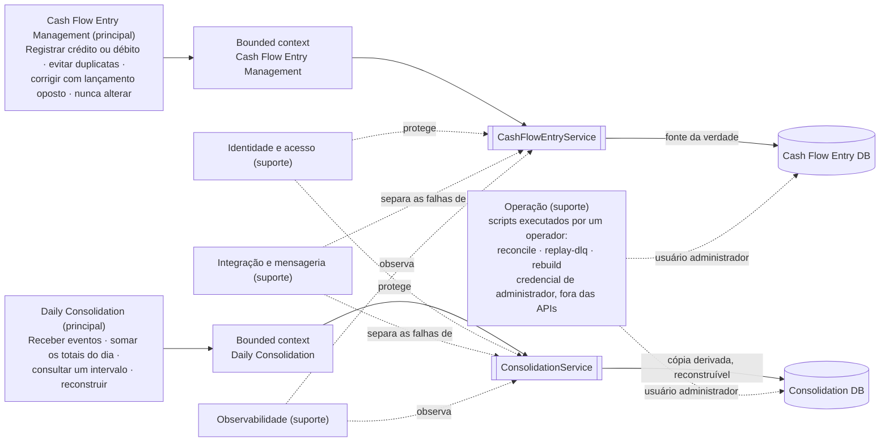

# Capacidades, domínios e fronteiras

## Objetivo

Este documento responde ao MR-01 (requisito obrigatório do PDF: "Mapeamento de domínios
funcionais e capacidades de negócio"). Ele divide o problema em capacidades — o que o negócio
precisa conseguir fazer — e em fronteiras: o limite dos dados e das regras que só um serviço pode
alterar. A divisão é primeiro de negócio e só depois de tecnologia. A regra central: um serviço só
cria e altera os dados que estão dentro da sua fronteira.

## Mapa de capacidades

O diagrama se lê da esquerda para a direita. Cada capacidade principal pertence a um domínio,
desenhado como um bounded context (contexto delimitado: uma parte do domínio com modelo e dados
próprios, que só ela altera), e cada contexto tem um serviço dono. Para cada serviço, a seta
mostra se o banco dele é a fonte da verdade (o dado oficial) ou uma cópia derivada, que pode ser
reconstruída. As capacidades de suporte, em linhas tracejadas, servem aos dois serviços.

Capacidade principal é a que entrega o valor do produto; capacidade de suporte é a que torna as
principais possíveis.



## Criticidade e valor por capacidade

A criticidade diz o que acontece se a capacidade parar: P0 (crítica) — o produto para;
P1 (importante) — uma função principal fica degradada ou desprotegida; P2 (de apoio) — registrar
e consultar continuam funcionando.

| Capacidade | Tipo e criticidade | Valor que gera | Por quê |
|---|---|---|---|
| Cash Flow Entry Management (gestão de lançamentos) | Principal, P0 | Registro confiável de cada crédito e débito. Sem ele, não há fluxo de caixa a controlar. | É o BR-01 (requisito de negócio do PDF: "Serviço que faça o controle de lançamentos"). Se parar, o produto para — e é exatamente esta capacidade que o NFR-001 protege (o Consolidado fora do ar não derruba Lançamentos). |
| Daily Consolidation (consolidação diária) | Principal, P1 | Mostra ao comerciante o saldo consolidado de cada dia, para ele decidir. | É o BR-02 (requisito de negócio do PDF: "relatório que disponibilize o saldo diário consolidado"). É consultada, e não é onde o dado nasce; por isso tolera alguns segundos de atraso (consistência eventual, ADR-005, decisão sobre o Consolidado) sem afetar o registro. |
| Identidade e acesso | Suporte, P1 | Garante que só quem se autenticou e tem permissão veja ou registre dados. | Sem autenticação e autorização — parte do OBJ-05 (critério de avaliação do PDF: segurança) —, as duas capacidades principais perdem a garantia de integridade que um produto financeiro exige. |
| Integração e mensageria | Suporte, P1 | Deixa Cash Flow Entry Management e Daily Consolidation evoluírem e falharem de forma independente. | É o que torna o NFR-001 possível: o Outbox (a mensagem gravada junto com o lançamento), novas tentativas e DLQ (Dead Letter Queue, fila das mensagens que não puderam ser processadas). Sem ela, separar os dois serviços perderia o sentido. |
| Observabilidade | Suporte, P2 | Mostra, com números, se as capacidades principais cumprem suas metas — os SLOs (Service Level Objectives, metas internas de nível de serviço) — e avisa quando algo falha. | Atende ao OBJ-04 (critério de avaliação: resiliência, com monitoramento proativo) e ao OBJ-08 (critério de avaliação: métricas e metas claras). É P2 porque, se ela parar, registrar e consultar continuam funcionando. |
| Operação | Suporte, P2 | Verifica e corrige o Consolidado quando ele diverge dos lançamentos: compara os totais, reenvia mensagens da DLQ e reconstrói os totais do zero. | Atende ao FR-007 e ao NFR-009 (requisitos refinados em `docs/01`: o Consolidado pode ser reconstruído a partir dos lançamentos). São scripts executados à mão por um operador, fora do caminho das requisições, com credenciais de administrador — e não com uma permissão (scope) de API. |

## Contextos delimitados (bounded contexts)

### Cash Flow Entry Management

É o contexto oficial dos lançamentos: o único que pode criar um registro financeiro. Ele é dono
do ciclo de vida do lançamento e da `Idempotency-Key`, o identificador que o cliente envia para
que repetir uma requisição não crie um segundo lançamento.

Implementado em: `CashFlowEntryService` e o banco dele.

### Daily Consolidation

É o contexto de leitura, derivado dos lançamentos. Ele é dono dos totais por dia, dos dados sobre
o processamento (por exemplo, quando o último evento foi aplicado) e da Inbox, a tabela que
registra os eventos já aplicados para descartar cópias repetidas. Não altera lançamentos e não
decide se uma operação financeira é válida.

Implementado em: `ConsolidationService` e o banco dele.

### Identidade e acesso

É uma capacidade de fora do domínio financeiro. Um provedor de identidade emite os tokens de
acesso; os serviços conferem a assinatura, o emissor (`issuer`), a API a que o token se destina
(`audience`) e as informações que ele carrega. A permissão (scope) decide quem pode acessar o quê;
ela não é uma regra do cálculo do saldo.

### Integração e mensageria

Entrega o evento `CashFlowEntryRecorded` de Lançamentos ao Consolidado sem perdê-lo, mesmo com falhas.
Usa o Outbox, novas tentativas, o ACK (acknowledgement: o Consolidado só confirma o
recebimento depois de gravar), a Inbox e a DLQ. O broker — o servidor de mensagens, aqui o
RabbitMQ — transporta a mensagem, mas não substitui a fonte da verdade, que é a tabela de
lançamentos.

### Observabilidade

Inclui o `correlationId` (identificador de correlação, que liga os logs de uma mesma operação nos
dois serviços), logs estruturados em JSON, métricas de tempo de resposta, de sucesso e de atraso
do Consolidado, mensagens acumuladas, DLQ e verificações de saúde (health checks). Com isso,
mostramos se as metas estão sendo cumpridas e enxergamos as falhas previstas quando elas
acontecem.

### Operação

A Operação não é uma aplicação: são três scripts de terminal que um operador executa à mão
quando precisa verificar ou corrigir o Consolidado. Eles nunca fazem parte do caminho de uma
requisição de API. Quando usar cada um, e o passo a passo, está em
[`docs/07-runbooks.md`](07-runbooks.md).

| Script | O que faz |
|---|---|
| `scripts/ops/reconcile.sh` | Soma, por dia, os créditos e os débitos da tabela de lançamentos e compara com os totais do Consolidado. Só lê; se algum dia divergir, mostra a diferença e termina com erro. |
| `scripts/ops/replay-dlq.sh` | Devolve à fila principal as mensagens que estão na DLQ, usando um shovel (recurso do RabbitMQ que transfere mensagens de uma fila para outra). |
| `scripts/ops/rebuild-consolidation.sh` | Apaga e recalcula os totais do Consolidado: a tarefa de `CashFlowEntryService` que publica o Outbox (o publisher) envia de novo todas as mensagens guardadas. Nunca altera a tabela `cash_flow_entries`. |

Os scripts usam credenciais de administrador — do banco em `reconcile.sh` e
`rebuild-consolidation.sh`, do RabbitMQ em `replay-dlq.sh` — porque precisam agir sobre os dois
serviços a partir de um só lugar. Os serviços, ao contrário, se conectam com usuários de banco que
só acessam o próprio banco ([`docs/05-aspectos-transversais.md`](05-aspectos-transversais.md)
§1). A Operação é a única capacidade que cruza de propósito a fronteira entre Lançamentos e
Consolidado: o rebuild altera o Outbox de `cashflow_entry_db`, mas só os campos que controlam a
publicação — nunca a tabela `cash_flow_entries`, que é a fonte da verdade.

## Mapa de contextos (context map)

O mapa mostra o que cada contexto fornece aos outros.

```text
Cash Flow Entry Management
   └── publica CashFlowEntryRecorded ──> Integração e mensageria
                                      └── entrega ──> Daily Consolidation

Provedor de identidade ── tokens ──> CashFlowEntryService e ConsolidationService
Observabilidade        <── sinais ── CashFlowEntryService, Broker e ConsolidationService
Operação (scripts de um operador, com credencial de administrador, fora das APIs)
   ├── marca o Outbox como pendente ──> Cash Flow Entry DB
   └── reconstrói os totais ──> Consolidation DB
```

A relação tem um único sentido — Lançamentos publica, o Consolidado consome —, para que o
Consolidado nunca vire uma dependência síncrona do registro. Um evento atrasado carrega a
`BusinessDate` definida no registro e atualiza o total do dia certo. Exemplo: um lançamento
registrado em 15/03 às 23:59, cujo evento só chega ao Consolidado em 16/03 às 00:02, entra nos
totais de 15/03.

## Invariantes que atravessam os contextos

As regras que valem nos dois contextos estão em
[`docs/01-requisitos-e-assumptions.md`](01-requisitos-e-assumptions.md#invariantes-e-regras-de-negócio):
um lançamento confirmado nunca muda (INV-001); o valor é um inteiro positivo em centavos de real
(BRL), e a natureza é `Credit` ou `Debit` (INV-002); uma instalação atende um único comerciante (A-021); o lançamento e a
mensagem do Outbox são gravados juntos (A-009); e os totais podem ser recalculados, sem nunca ser
a fonte oficial do dado financeiro (A-005).

## Fora das fronteiras desta entrega

Não fazem parte desta entrega: interface gráfica, provedor de identidade de produção, várias
moedas, várias contas por comerciante, Kubernetes, implantação em nuvem, várias regiões e Event
Sourcing (guardar só os eventos e calcular o estado a partir deles; ver ADR-001, decisão sobre o
estilo de arquitetura). O motivo de cada item está em
[`docs/01-requisitos-e-assumptions.md`](01-requisitos-e-assumptions.md#fora-do-escopo).

## Por que estas duas fronteiras

O corte segue a regra mais importante do desafio: a consulta fora do ar não pode interromper o
registro. Ele também separa o modelo de escrita, em que um lançamento nunca muda depois de
gravado, do modelo de consulta, que pode ficar alguns segundos atrás e ser reconstruído. Assim, a
consistência eventual e a reconstrução ficam explícitas no desenho.
