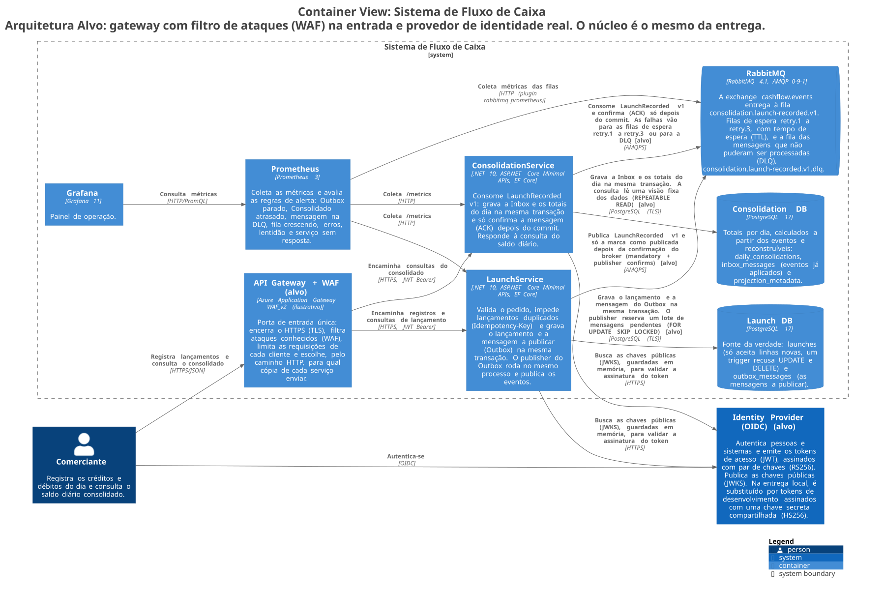
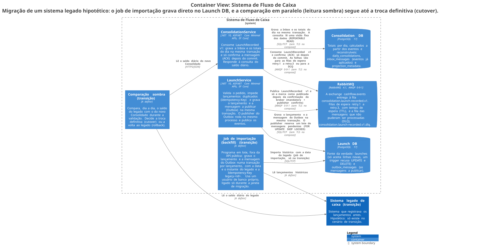

# Arquitetura Alvo

Este documento descreve como a solução rodaria em produção — a Arquitetura Alvo — e o que muda
em relação ao ambiente local desta entrega. Ele responde ao MR-03, requisito obrigatório do PDF
que pede o "Desenho da solução completo (Arquitetura Alvo)". Nada do que está aqui foi
implementado: o desafio não pede nuvem, Kubernetes nem várias regiões. Mesmo assim, o lugar de
cada peça está decidido e registrado, para que nada fique em aberto.

O núcleo é o mesmo que roda localmente: os dois serviços, o Outbox, o consumidor e as filas. Em
produção, entram cinco mudanças:

- uma porta de entrada única, o API Gateway, com WAF (Web Application Firewall, filtro que
  bloqueia ataques conhecidos, como injeção de SQL);
- um provedor de identidade real, que autentica as pessoas e os sistemas e emite os tokens de
  acesso;
- PostgreSQL gerenciado pelo provedor de nuvem, com uma cópia de cada banco;
- RabbitMQ em cluster de 3 servidores (nós);
- o mesmo Prometheus e o mesmo Grafana desta entrega, uma cópia de cada, rodando como containers
  no mesmo ambiente de nuvem do `ConsolidationService`, mais um serviço gerenciado de logs (Azure
  Monitor Log Analytics, na estimativa de custos), que recebe e guarda os logs dos dois serviços.

O que vale nos dois ambientes — segurança, resiliência e observabilidade — está em
[`docs/05-aspectos-transversais.md`](05-aspectos-transversais.md). As decisões, com as
alternativas descartadas, estão nos ADRs (Architecture Decision Records, registros de decisão de
arquitetura), em [`docs/adr/`](adr/README.md). Aqui fica só o que muda em produção.

## 1. Visão geral

O diagrama segue o modelo C4 (forma padronizada de desenhar arquitetura em quatro níveis de
zoom), no nível C2 (containers): cada aplicação, banco e broker — o servidor de mensagens, aqui o
RabbitMQ — e como eles se comunicam. Os elementos que só existem na Arquitetura Alvo levam
"(alvo)" no nome.

O modelo completo está em [`docs/diagrams/structurizr/workspace.dsl`](diagrams/structurizr/workspace.dsl),
escrito em DSL (Domain-Specific Language, a linguagem própria da ferramenta Structurizr). A lista
de todos os diagramas está em [`docs/diagrams/README.md`](diagrams/README.md).

| Componente | O que faz | Dono | Protocolo | Onde guarda os dados |
|---|---|---|---|---|
| **API Gateway** | Porta de entrada de todas as requisições. Encerra a conexão criptografada — TLS (Transport Layer Security), o "S" do HTTPS —, aplica as regras do WAF, limita as requisições de cada cliente, envia cada requisição a uma cópia saudável do serviço e cuida do identificador de correlação (`X-Correlation-Id`). | Time de plataforma | HTTPS | — |
| **`CashFlowEntryService`** (Lançamentos), com a API e o publisher do Outbox no mesmo processo ([ADR-011](adr/ADR-011-topologia-de-processos.md)) | Valida o pedido, impede lançamentos duplicados (`Idempotency-Key`), grava o lançamento e a mensagem a publicar na mesma transação e publica os eventos. | Time de Lançamentos | HTTPS com REST (Representational State Transfer, estilo de API sobre HTTP) na entrada; AMQP (Advanced Message Queuing Protocol, o protocolo do RabbitMQ) na saída | `Cash Flow Entry DB` |
| **`Cash Flow Entry DB`** (banco de Lançamentos) | Fonte da verdade: a tabela de lançamentos e o Outbox, a tabela das mensagens a publicar. | Time de Lançamentos | Protocolo do PostgreSQL, com TLS | PostgreSQL gerenciado: um servidor principal e uma cópia de espera síncrona (standby síncrono), que confirma cada gravação junto com o principal |
| **RabbitMQ** (cluster) | Transporta o evento `CashFlowEntryRecorded.v1` sem perdê-lo: filas duráveis, confirmação manual de cada mensagem pelo consumidor — o ACK (acknowledgement) —, filas de espera para novas tentativas e a DLQ (Dead Letter Queue, fila das mensagens que não puderam ser processadas). | Time de plataforma | AMQP 0-9-1 com TLS | Filas replicadas nos 3 nós (quorum queues) |
| **`ConsolidationService`** (Consolidado), com a API e o consumidor no mesmo processo | Consome os eventos, descarta os repetidos, atualiza os totais de cada dia e responde às consultas por intervalo. | Time do Consolidado | AMQP na entrada; HTTPS com REST para quem consulta | `Consolidation DB` |
| **`Consolidation DB`** (banco do Consolidado) | Os totais por dia, calculados a partir dos eventos e reconstruíveis. Nunca é a fonte de um valor financeiro. | Time do Consolidado | Protocolo do PostgreSQL, com TLS | PostgreSQL gerenciado: um servidor principal e uma réplica de leitura assíncrona (read replica), que recebe as gravações com alguns segundos de atraso |
| **Provedor de identidade** | Autentica pessoas e sistemas pelo padrão OIDC (OpenID Connect, login sobre o OAuth 2.0) e emite tokens assinados com RS256 (assinatura com par de chaves: o provedor assina com a chave privada e os serviços validam com a pública). Publica as chaves públicas num endereço JWKS (JSON Web Key Set). | Externo, não implementado | OIDC e OAuth 2.0, sobre HTTPS | — |
| **Plataforma de observabilidade** | O Prometheus coleta as métricas e avalia as 9 regras de alerta; o Grafana mostra o painel; o serviço gerenciado guarda os logs dos dois serviços e permite buscá-los, por exemplo pelo `correlationId`. Ninguém é avisado automaticamente: o envio dos alertas por e-mail ou chat (Alertmanager) é uma evolução, fora da estimativa de custos (§9). | Time de plataforma | Métricas: o Prometheus busca `/metrics` de cada cópia; logs: HTTPS até o serviço gerenciado | Prometheus e Grafana: uma cópia de cada, sem alta disponibilidade, em containers no ambiente de nuvem do `ConsolidationService`. Logs: Azure Monitor Log Analytics ([`docs/08-custos.md`](08-custos.md) §2) |

## 2. Comunicação

Cada ligação abaixo diz se quem chama espera a resposta (síncrona) ou não (assíncrona), por quê,
e o que acontece com a disponibilidade, o tempo de resposta e a consistência dos dados.

- **Cliente → API Gateway → `CashFlowEntryService` ou `ConsolidationService`.** Síncrona, HTTPS com JSON
  (REST). Quem chama precisa da resposta na hora. Cada API depende só de si mesma e do próprio
  banco, nunca da outra. O tempo de resposta tem meta por operação, em p95 e p99 (os valores
  abaixo dos quais ficam 95% e 99% das respostas), definida no NFR-013 (requisito: metas de
  tempo de resposta). Dentro de cada serviço, quem grava e lê em seguida vê o próprio dado. Para
  operar, o gateway verifica a saúde de cada cópia e só envia requisições às saudáveis.
- **`CashFlowEntryService` → provedor de identidade.** Síncrona, mas só quando o serviço busca ou
  renova as chaves públicas (JWKS), que ficam guardadas em memória — não a cada token. A emissão
  do token acontece entre o cliente e o provedor, sem passar pelo `CashFlowEntryService`. Assim, o
  serviço valida a assinatura sem uma ida e volta ao provedor por requisição, e as chaves
  guardadas aguentam uma queda curta do provedor. Quando o provedor troca as chaves, a cópia
  guardada precisa ser renovada.
- **`CashFlowEntryService` → `Cash Flow Entry DB`.** Síncrona. O lançamento e a mensagem do Outbox são gravados
  juntos, numa transação: tudo ou nada (ADR-003, decisão sobre o Outbox). Com o banco fora do
  ar, o registro é recusado, sem alternativa — o NFR-A (requisito do PDF: Lançamentos não pode
  cair se o Consolidado cair) fala do Consolidado, não do próprio banco. Esse tempo entra no p95
  e no p99 do registro. O RPO (Recovery Point Objective, perda máxima aceitável de dados) igual
  a zero — nenhum lançamento confirmado se perde — depende do standby síncrono (§5).
- **`CashFlowEntryService` → RabbitMQ.** Assíncrona: uma tarefa em segundo plano, o publisher do
  Outbox, publica fora da requisição HTTP, por AMQP 0-9-1. Isso separa a disponibilidade do
  registro da disponibilidade do broker (ADR-002, decisão sobre a integração assíncrona). Com o
  broker fora do ar, o registro continua e as mensagens se acumulam no Outbox; o tempo de
  resposta não muda. O Consolidado recebe o evento depois (consistência eventual). A quantidade e
  a idade das mensagens que esperam no Outbox aparecem nas métricas `outbox_pending_count` e
  `outbox_oldest_age_seconds`.
- **RabbitMQ → `ConsolidationService`.** Assíncrona, com entrega "pelo menos uma vez"
  (at-least-once): nada se perde, mas a mesma mensagem pode chegar duas vezes. O consumidor
  confirma cada mensagem (ACK manual) e processa no próprio ritmo. Com o Consolidado fora do ar,
  Lançamentos não é afetado (NFR-001, requisito: o Consolidado fora do ar não derruba
  Lançamentos). Essa ligação define o atraso do Consolidado (`consumer_lag_seconds`, NFR-005:
  95% dos lançamentos aparecem na consulta em até 5 s). A Inbox, a tabela dos eventos já
  aplicados, descarta as cópias repetidas (ADR-004, decisão sobre idempotência). O tipo da falha
  decide a nova tentativa: temporária ou inesperada (ADR-011, decisão sobre onde rodam o
  publisher e o consumidor).
- **`ConsolidationService` → `Consolidation DB`.** Síncrona. A Inbox e os totais do dia são
  gravados na mesma transação, antes do ACK. Com o banco fora do ar, a mensagem não é dada como
  processada: volta das filas de espera até o banco voltar, e nunca se perde. Esse tempo entra
  no atraso do Consolidado. Uma réplica assíncrona basta,
  porque os totais podem ser reconstruídos.
- **Serviços → plataforma de observabilidade.** Assíncrona e fora do caminho das requisições: o
  Prometheus busca as métricas (scrape), ou os serviços as enviam por OTLP (OpenTelemetry
  Protocol, protocolo padrão para enviar métricas, logs e rastreamento). Nunca acrescenta tempo a
  uma requisição, e a observabilidade fora do ar não afeta o sistema observado. Retenção e
  alertas são responsabilidade da plataforma, não dos serviços.

## 3. Fluxos de dados

Os programas implantados são os mesmos dois do diagrama C2 da entrega
([`docs/diagrams/README.md`](diagrams/README.md)): o publisher do Outbox e o consumidor rodam
dentro do processo da própria API, nunca como programas separados (ADR-011). O que a tabela
mostra é a direção e o momento de cada caminho de dado.

| # | Caminho | Síncrono ou assíncrono | De → para | Observação |
|---|---|---|---|---|
| 1 | Registro | Síncrono: termina com a resposta `201` | Cliente → `CashFlowEntryService` → `Cash Flow Entry DB` | Nenhum outro caminho participa da resposta. |
| 2 | Publicação | Assíncrono, fora da requisição HTTP | Publisher do Outbox, no processo de `CashFlowEntryService` → RabbitMQ | O mesmo evento pode ser publicado duas vezes. É esperado, e não um defeito. |
| 3–4 | Atualização do Consolidado | Assíncrono, "pelo menos uma vez" | RabbitMQ → consumidor, no processo de `ConsolidationService` → `Consolidation DB` → ACK | O ACK só acontece depois da confirmação (commit) no `Consolidation DB`. |
| 5 | Consulta | Síncrono | Cliente → `ConsolidationService` → `Consolidation DB` | Nunca toca o `Cash Flow Entry DB` nem o broker. |
| 6 | Reconstrução (rebuild) | Manual, quando um operador decide | `scripts/ops/rebuild-consolidation.sh` → relê o Outbox (`outbox_messages`) no `Cash Flow Entry DB` → recalcula o `Consolidation DB` | Relê o Outbox, e não o broker, porque o broker não é a fonte da verdade (A-008, premissa: o broker só transporta mensagens). |

- **Fonte da verdade:** a tabela `cash_flow_entries`, no `Cash Flow Entry DB`. Todo o resto é calculado a partir
  dela, direta ou indiretamente.
- **Dados derivados:** o Outbox (gravado na mesma transação do lançamento), o evento
  `CashFlowEntryRecorded.v1` em trânsito no broker, e a Inbox e os totais por dia
  (`daily_consolidations`) no `Consolidation DB`. Esses dois últimos podem ser reconstruídos a
  qualquer momento pelo caminho 6, sem envolver o cliente.

## 4. Alta disponibilidade (HA)

Alta disponibilidade — HA (High Availability) — é manter o serviço no ar quando uma peça falha:
cada peça tem cópias, e uma falha passa o trabalho para a cópia saudável (failover). Na nuvem,
as cópias ficam em zonas de disponibilidade diferentes — AZ (Availability Zone, um data center
isolado dentro de uma região) —, para que a queda de uma zona não derrube o serviço. Um
balanceador de carga distribui as requisições entre as cópias e tira de circulação a que não
responde à verificação de saúde. Esta seção trata só de falhas; crescer com a carga é a §6.

| Componente | Cópias | Se uma cópia falhar | Quanto demora | O que ainda derruba o componente | Por que aceitamos |
|---|---|---|---|---|---|
| **API Gateway** | Pelo menos 2 cópias, em zonas diferentes, atrás de um balanceador de carga que escolhe o destino pela camada de aplicação (§7) | O balanceador tira de circulação a cópia que falha na verificação de saúde | Segundos, até a próxima verificação | — | — |
| **`CashFlowEntryService`** | Pelo menos 2 cópias (réplicas), em pelo menos 2 zonas | O balanceador só envia requisições a quem responde bem em `/health/ready`; a cópia que falha sai de circulação | Segundos | — | O serviço não guarda estado: qualquer cópia atende qualquer requisição |
| **`Cash Flow Entry DB`** | PostgreSQL gerenciado, com **standby síncrono** em outra zona | O provedor promove o standby a principal, automaticamente | Em geral, menos de 1 minuto, conforme o provedor | A região inteira, se não houver DR (Disaster Recovery, recuperação em outra região) | O RPO 0 depende de o standby ser síncrono: aceitamos gravações um pouco mais lentas em troca dessa garantia (§5) |
| **RabbitMQ** | Cluster de 3 nós com **quorum queues** (filas replicadas), e não as filas clássicas espelhadas, que o RabbitMQ descontinuou | Os nós que restam escolhem um novo nó líder para cada fila | De um a poucos segundos | O cluster inteiro, se a região cair | Nada nesta entrega exige várias regiões (A-014, premissa: as metas de disponibilidade são objetivos iniciais, sem contrato com o cliente) |
| **`ConsolidationService`** | Pelo menos 2 cópias, em pelo menos 2 zonas | Como em `CashFlowEntryService`; os consumidores das cópias disputam a mesma fila | Segundos | — | O serviço não guarda estado: o consumidor de qualquer cópia processa qualquer mensagem |
| **`Consolidation DB`** | PostgreSQL gerenciado, com uma **réplica de leitura assíncrona** | **Manual:** um operador promove a réplica. Opção mais barata: nenhuma réplica, só backup e reconstrução a partir do Outbox. Nunca troca automática pelo provedor | De minutos, na promoção manual, até o RTO (Recovery Time Objective, tempo máximo para voltar) de 60 minutos, na reconstrução | A região | Os totais podem ser reconstruídos (A-005, premissa: os lançamentos são a fonte da verdade e os totais são calculados a partir deles). Perder alguns segundos de replicação não é perder dinheiro; por isso, nem o standby síncrono nem a troca automática se pagam aqui |
| **Observabilidade** | Uma cópia do Prometheus e uma do Grafana — os mesmos desta entrega —, sem alta disponibilidade, mais o serviço gerenciado de logs, cuja disponibilidade é responsabilidade do provedor | Não se aplica: fica fora do sistema observado | — | A própria plataforma | Se a observabilidade cair, o sistema observado continua funcionando |

**A diferença entre os dois bancos é a decisão central desta seção.** O `Cash Flow Entry DB` paga por um
standby síncrono porque não pode perder nenhum lançamento confirmado (NFR-004, requisito: RPO
igual a zero; A-005). O `Consolidation DB` não paga, porque os totais podem ser descartados e
recalculados. É a mesma assimetria do resto da arquitetura (ADR-001, decisão sobre o estilo
arquitetural; ADR-005, decisão sobre a consistência eventual), aplicada aos dados.

## 5. Perda máxima de dados (RPO) e tempo de recuperação (RTO)

O RPO diz quanto dado se aceita perder numa falha, medido em tempo: RPO 0 quer dizer que nenhum
lançamento confirmado ao cliente se perde. O RTO diz quanto tempo o componente pode ficar fora:
RTO de 15 minutos quer dizer que, 15 minutos depois da falha, ele precisa estar funcionando de
novo. As metas vêm do NFR-014 (requisito: metas de recuperação).

| Componente | RPO | RTO | Como |
|---|---|---|---|
| `Cash Flow Entry DB` | **0** | Até 15 minutos (NFR-014) | Standby síncrono em outra zona: o cliente só recebe a confirmação depois que a gravação chegou ao standby. |
| `Consolidation DB` | Minutos, pela replicação assíncrona — **aceitável, porque não é fonte de valor financeiro** | Até 60 minutos (NFR-014) | Réplica de leitura assíncrona com promoção **manual**, ou reconstrução completa a partir do Outbox (A-012, premissa: as mensagens publicadas ficam guardadas no Outbox, sem prazo; ADR-003). Na prática, a reconstrução é um "RPO 0 lento": nenhum lançamento se perde, só se gasta o tempo de reprocessar. |
| RabbitMQ | **0 para mensagens confirmadas**: a quorum queue grava a mensagem na maioria dos nós (2 de 3) antes de confirmar ao publisher. Mesmo assim, não é o RPO do sistema, porque o broker não é a fonte da verdade (A-008): se uma mensagem confirmada se perdesse, `scripts/ops/reconcile.sh` encontraria a diferença e a reconstrução (FR-007, requisito: reconstruir o Consolidado do zero) a corrigiria a partir do Outbox. Os lançamentos nunca seriam afetados. | Minutos: religar o cluster ou promover um nó | Quorum queues replicadas nos 3 nós. |
| `CashFlowEntryService` e `ConsolidationService` | Não se aplica: não guardam estado | Segundos: uma nova cópia sobe atrás do balanceador | Nada a recuperar; o estado fica nos bancos. |

**Filas clássicas e quorum queues.** No ambiente local, com um único nó, as filas são declaradas
sem o argumento `x-queue-type` (`QueueDeclareAsync`, em `CashFlowEntryRecordedConsumerService.cs`) e
ficam com o tipo padrão, clássico. Na Arquitetura Alvo, a mesma declaração passaria
`x-queue-type: quorum`. A mudança é pequena: uma opção de configuração nova, que não existe nesta
entrega (por exemplo, `RabbitMq:QueueType`, lida na inicialização), e o argumento na mesma
declaração de fila — nenhum componente novo. Não está ligada aqui porque uma quorum queue exige
um cluster de pelo menos 3 nós, que o Docker Compose local não tem.

**Atraso de replicação e "ler a própria gravação".**

- As leituras de `CashFlowEntryService` — por exemplo, `GET /entries/{id}` logo depois de um `POST` —
  vão **sempre para o servidor principal** do `Cash Flow Entry DB`, nunca para o standby. Assim, quem
  acabou de gravar sempre encontra o próprio lançamento. O custo é não aliviar a leitura no
  principal, o que é aceitável: Lançamentos tem pouco volume de leitura, comparado ao Consolidado.
- O Consolidado fica alguns segundos atrás **por desenho** (ADR-005), e não por causa da
  replicação: mesmo lendo do servidor principal do `Consolidation DB`, o valor mostrado reflete o
  último evento *aplicado*, e não o último lançamento *criado*. O cliente vê esse atraso nos campos
  `asOfUtc` e `lastAppliedLagSeconds` da resposta ([`docs/03-contratos.md`](03-contratos.md)); não
  precisa adivinhá-lo.
- Se o `Consolidation DB` um dia precisar de mais réplicas de leitura (§6), elas somam o próprio
  atraso ao que a consulta já mostra: um atraso a mais no mesmo sentido, já visível ao cliente, e
  não um novo tipo de dado desatualizado.

## 6. Escalabilidade

**Horizontal, com mais cópias, é a forma principal de crescer.**

- `CashFlowEntryService` e `ConsolidationService` não guardam estado: quantas cópias forem precisas,
  atrás do gateway, sem prender um cliente a uma cópia.
- Publisher do Outbox: cada cópia de `CashFlowEntryService` reserva um lote de mensagens que nenhuma
  outra cópia pode pegar ao mesmo tempo (no PostgreSQL, `SELECT ... FOR UPDATE SKIP LOCKED`,
  ADR-003). Assim, várias cópias publicam juntas sem uma trava externa, e cada uma pega linhas
  diferentes do Outbox.
- Consumidor: as cópias de `ConsolidationService` disputam a mesma fila do RabbitMQ e dividem as
  mensagens acumuladas sozinhas, sem configuração extra. É o modo de consumo padrão do AMQP.

**Vertical, com uma máquina maior.** Mais processador — CPU (Central Processing Unit) — e mais
IOPS (operações de leitura e escrita em disco por segundo) no banco vêm antes de dividir os dados
em vários servidores. O caminho completo de crescimento do PostgreSQL — máquina maior, réplicas de
leitura do Consolidado, particionamento das tabelas, banco SQL distribuído — está no
[ADR-008](adr/ADR-008-postgresql.md), decisão sobre o PostgreSQL. São opções, e não uma sequência
obrigatória.

**Quando criar mais cópias automaticamente (autoscaling):**

| Componente | Sinal principal | Sinal secundário |
|---|---|---|
| `CashFlowEntryService` | Requisições por segundo, por cópia | Uso de CPU |
| `ConsolidationService`, API | Requisições por segundo, por cópia | Uso de CPU |
| `ConsolidationService`, consumidor (dentro da mesma cópia) | Quantidade de mensagens na fila principal (`rabbitmq_queue_messages`) | `consumer_lag_seconds` |

A API e o consumidor de `ConsolidationService` rodam no mesmo processo (ADR-011). Por isso,
criar mais cópias por causa das consultas também aumenta a capacidade de consumo. O sinal da fila
e do atraso mostra quando isso não basta: se a fila cresce enquanto as consultas por segundo
ficam estáveis, quem pressiona o consumidor é o volume de *escrita*, e não o de leitura.

**Criar cópias antes de um pico conhecido.** Se o horário de pico é previsível — por exemplo, o
fechamento do caixa no fim do dia —, criar cópias de `ConsolidationService` antes do horário evita
que o autoscaling reaja tarde. O sinal da fila só cresce *depois* que as mensagens já começaram a
se acumular.

**A fila absorve picos (queue-based load leveling).** O RabbitMQ fica entre a velocidade com que
Lançamentos produz eventos e a velocidade com que o Consolidado os consome. Um pico de escrita
vira uma fila temporária, e não uma pressão direta sobre o Consolidado. É o próprio padrão da
integração assíncrona (ADR-002), e não uma peça nova.

**Sinal para desacelerar (backpressure).** Cada consumidor recebe no máximo 10 mensagens ainda não
confirmadas por vez (`BasicQosAsync(prefetchCount: 10, ...)`). Assim, uma cópia não puxa mais
trabalho do que consegue fazer. Do lado HTTP, o limitador de requisições por chamador
([`docs/05-aspectos-transversais.md` §1](05-aspectos-transversais.md#1-segurança-e-modelo-de-ameaças))
impede que um cliente descontrolado esgote a capacidade de todos.

**Capacidade para 50 requisições por segundo**, com os números reais medidos em
[`docs/evidence/load/`](evidence/load/2026-10-19-consolidation.md), e não estimados:

- **Consulta do Consolidado:** 50 requisições por segundo durante 2 minutos, contra o ambiente
  real (uma cópia de cada serviço, numa máquina de desenvolvimento): p95 de 6,1 ms, p99 de 8,0 ms,
  0% de falha. As metas do NFR-013 (p95 até 500 ms, p99 até 2000 ms) ficam cerca de 80 e 250 vezes
  acima do medido, numa única cópia não dimensionada para produção. A 50 requisições por segundo,
  a capacidade não é o limite; o que ainda não sabemos é como o sistema se comporta numa escala
  muito maior, porque isso não foi testado.
- **Registro de lançamentos:** 50 requisições por segundo durante 2 minutos: p95 de 5,8 ms, p99 de
  7,6 ms. Durante o teste, `consumer_lag_seconds` ficou em 0,7 s no p95 e 0,9 s no p99, bem dentro
  da meta do NFR-005 (p95 até 5 s). No fim, o Outbox e a fila principal estavam vazios
  (confirmado).
- **Carga alta constante não é o mesmo que um pico.** Os números acima vêm de 2 minutos a 50
  requisições por segundo constantes, e não de um pico curto seguido de pausa. Um pico curto cabe
  na folga que já existe (a fila e o limite de 10 mensagens por consumidor). Uma carga
  **constantemente** alta, por horas, exigiria dimensionar as cópias para esse patamar o tempo
  todo, e não confiar na folga de um teste de minutos. A premissa A-013 trata 50 lançamentos por
  segundo durante 15 minutos como pico, e não como carga 24 horas por dia. Se isso mudar, o teste
  precisa ser refeito com a duração real esperada (`scripts/load/run.sh entries 15m` já reproduz
  a janela completa da A-013).
- **Janela completa da A-013 (15 minutos), já executada:** 45001 requisições, 0% de falha, nenhuma
  deixada de enviar por falta de capacidade (`dropped_iterations` igual a 0), p95 de 5,75 ms e p99
  de 8,07 ms. É a mesma ordem de grandeza do teste de 2 minutos, sem piora na janela mais longa.
  `consumer_lag_seconds` ficou em 0,69 s no p95 e 0,94 s no p99; no fim, o Outbox e a fila
  principal estavam vazios. Relatório completo em
  [`docs/evidence/load/2026-10-20-launches.md`](evidence/load/2026-10-20-launches.md).

## 7. Cache e balanceamento

**Cache: decidimos não usar por ora** ([ADR-012](adr/ADR-012-borda-gateway-waf-cache.md), decisão
sobre a entrada do sistema). A consulta já lê totais prontos, um por dia, e responde muito abaixo da
meta (§6). Se a evidência futura pedir um cache, ele entraria de uma destas formas:

- **Validação pela versão dos totais (`ETag` e `If-None-Match`).** A resposta já traz o campo
  `projectionVersion` ([`docs/03-contratos.md`](03-contratos.md)). O servidor enviaria essa
  versão no cabeçalho `ETag`; o cliente a devolveria em `If-None-Match` na consulta seguinte; e,
  se nada mudou, o servidor responderia `304 Not Modified`, sem corpo. É barato e não serve dado
  velho, porque a versão muda exatamente quando o dado muda.
- **Cache de poucos segundos por intervalo de datas.** Por exemplo, num Redis ou na memória do
  próprio serviço, com a chave `(fromDate, toDate)`, descartado quando `projectionVersion` mudar.
  Reduziria a carga no banco quando muitos clientes consultam o mesmo intervalo ao mesmo tempo,
  ao custo de mais uma dependência.

**Balanceamento.** O API Gateway (§1) escolhe o destino de cada requisição pela camada de
aplicação, olhando o caminho e os cabeçalhos HTTP (a camada 7, a de aplicação, no modelo de sete
camadas usado para descrever redes). Ele consulta `/health/ready` de cada cópia: uma cópia que
responde "não pronta" — por exemplo, porque o próprio banco está fora do ar — sai de circulação
sem intervenção manual. Nenhum cliente fica preso a uma cópia: qualquer cópia de `CashFlowEntryService`
ou de `ConsolidationService` atende qualquer requisição daquele serviço.

## 8. Segurança na arquitetura alvo

Os controles desta entrega, com o modelo de ameaças e os testes que os comprovam, estão em
[`docs/05-aspectos-transversais.md` §1](05-aspectos-transversais.md#1-segurança-e-modelo-de-ameaças).
Esta tabela compara cada controle com o que muda em produção.

| Controle | Nesta entrega (local) | Na Arquitetura Alvo |
|---|---|---|
| Autenticação | Token JWT (JSON Web Token, o token de acesso assinado) com HS256 (assinatura com uma chave secreta compartilhada por quem assina e quem valida), só para desenvolvimento ([ADR-007](adr/ADR-007-identity-provider-externo.md), decisão sobre o provedor de identidade) | Provedor de identidade real emitindo tokens RS256; os serviços validam com a chave pública obtida no JWKS e guardada em memória. Nenhum serviço conhece um segredo de assinatura. |
| Autorização | Permissões (scopes) por operação; o mesmo `audience` (`cashflow-api`, o campo do token que diz para qual API ele vale) nas duas APIs | Perfis de pessoas convertidos em permissões, e um `audience` por API como segunda barreira (ADR-007, "Quando revisitar"). |
| Criptografia em trânsito (TLS) | **Não implementada**: os containers conversam na rede interna do Docker | O gateway encerra o HTTPS; as conexões dos serviços com o PostgreSQL e com o RabbitMQ usam TLS. TLS mútuo — mTLS, em que os dois lados apresentam certificado — entre serviço e broker é uma evolução opcional. |
| Limite de requisições | Por chamador autenticado, dentro de cada serviço; uma requisição sem token recebe `401` antes de chegar ao limitador ([ADR-012](adr/ADR-012-borda-gateway-waf-cache.md)) | O gateway com WAF contém uma enxurrada de requisições sem token antes de qualquer autenticação. O limitador por chamador continua nos serviços como segunda barreira (defesa em profundidade), e não como substituto. |
| Proteção contra ataques (WAF) | **Não implementada** (ADR-012) | WAF no gateway, com regras genéricas e regras específicas para APIs. |
| Isolamento de dados | Um usuário de banco sem poderes de administrador por serviço. A permissão de conexão que o PostgreSQL dá a todos (`PUBLIC`) foi retirada: além do administrador, só o usuário do próprio serviço se conecta ao seu banco ([ADR-006](adr/ADR-006-isolamento-de-dados.md), [ADR-008](adr/ADR-008-postgresql.md)) | O mesmo modelo, com TLS obrigatório na conexão e senhas trocadas periodicamente pelo cofre de segredos. |
| Segredos | No `docker-compose.yml`, de propósito, só para desenvolvimento | Um cofre de segredos gerenciado — por exemplo, o KMS (Key Management Service) do provedor de nuvem — e a identidade do próprio serviço na nuvem (managed identity), sem senha guardada. Nenhum segredo no repositório. |
| Criptografia dos dados em disco | Não configurada (volumes locais) | O provedor criptografa os bancos, os backups e os volumes do broker. |
| Containers sem administrador | Implementado (`USER $APP_UID` nos dois Dockerfiles) | Mantido. |
| Lançamentos só por inclusão (append-only) | Um trigger do banco recusa alteração e remoção; veja o risco abaixo | Veja o risco abaixo. |
| Painéis de administração: RabbitMQ (porta 15672), Grafana (3000, com acesso anônimo), Prometheus (9090) e PostgreSQL (5433) | Portas abertas só na máquina do avaliador, sem exposição pública | Sem exposição pública. Acesso só por VPN (Virtual Private Network, rede privada virtual) ou por uma máquina de acesso controlado (bastion) na rede privada; Grafana sem acesso anônimo. |
| Credencial de administrador do broker | Um único usuário administrador do RabbitMQ (`cashflow`), usado pelos dois serviços, por `scripts/ops/replay-dlq.sh` e pelo painel de administração (`docker-compose.yml`; A-023, premissa sobre essa credencial) | Uma credencial por serviço e por script, cada uma só com as permissões de que precisa no broker (permissões por vhost, o espaço lógico de filas do RabbitMQ), e não um administrador compartilhado. |

### Risco que resta no append-only

Hoje, `cashflow_entry_svc` — o usuário de banco com que `CashFlowEntryService` se conecta — é dono do schema onde
fica a tabela `cash_flow_entries`, porque as migrações automáticas precisam disso. Por isso, quem roubar
essa credencial poderia, em tese, apagar o trigger (`DROP TRIGGER`) e alterar lançamentos. O risco
está aceito e explicado na premissa A-024
([`docs/01-requisitos-e-assumptions.md`](01-requisitos-e-assumptions.md#premissas-assumptions)).

**Na Arquitetura Alvo**, dois usuários de banco separam as funções. Um usuário de implantação, dono
do schema, roda as migrações e pode alterar tabelas e triggers. O usuário com que o serviço roda
recebe **apenas `INSERT` e `SELECT`** em `cash_flow_entries`, nunca `ALTER`, `DROP` ou `TRIGGER`. Assim,
nem uma credencial do serviço roubada consegue desligar a proteção. As migrações automáticas do
ambiente `Development` (`ApplyMigrationsOnStartup`) passariam a usar o usuário de implantação.

## 9. Falhas e como o sistema reage (failure modes)

O que acontece em cada falha no ambiente local — e o que garante que nada se perde — está em
[`docs/05-aspectos-transversais.md` §2](05-aspectos-transversais.md#2-resiliência-e-recuperação);
eventos repetidos e mensagens que sempre falham estão no
[ADR-004](adr/ADR-004-processamento-idempotente.md) e no
[runbook §4](07-runbooks.md#4-dlq-não-vazia). Esta tabela mostra o que muda em produção, com
várias cópias e serviços gerenciados.

| Falha | Efeito | O que contém a falha | O que ainda pode dar errado |
|---|---|---|---|
| `Cash Flow Entry DB` fora do ar | Lançamentos não consegue registrar. Não é por causa do Consolidado — o NFR-001 continua cumprido —, e sim porque a própria fonte da verdade caiu. Nenhum desenho com dois serviços evita a queda do banco de um deles. | Standby síncrono e troca automática (§4), dentro do RTO do NFR-014; [runbook §6](07-runbooks.md#6-entry-db-fora-do-ar) | O RPO 0 depende de o standby estar de fato síncrono e saudável. |
| `Consolidation DB` fora do ar | O consumidor devolve as mensagens às filas de espera indefinidamente, sem mandá-las à DLQ enquanto a falha for temporária; o Consolidado fica atrasado. | Classificação da falha como temporária (ADR-011); [runbook §3](07-runbooks.md#3-consolidation-db-fora-do-ar-ou-indisponibilidade-de-qualquer-duração) | Se a queda passar do RTO de 60 minutos, o alerta mostra o problema, mas nada o corrige sozinho. |
| Broker fora do ar | As mensagens se acumulam no Outbox; o Consolidado para de receber eventos novos; Lançamentos não é afetado (NFR-001). | O publisher tenta de novo, esperando cada vez mais entre as tentativas; cluster de 3 nós; [runbook §1](07-runbooks.md#1-broker-rabbitmq-fora-do-ar) | O Outbox pode crescer a ponto de pressionar o disco (alerta `OutboxStale`). |
| Publisher do Outbox parado, ou caindo e reiniciando em sequência | Os lançamentos continuam sendo aceitos, mas os eventos não são publicados. | O publisher captura as exceções sem derrubar o processo (ADR-011); o container é reiniciado automaticamente. | Se o processo inteiro cair, a API do mesmo processo cai junto. |
| Consumidor parado, ou caindo e reiniciando em sequência | O Consolidado para de atualizar; a API de consulta, no mesmo processo, também cai (as duas partes caem juntas, ADR-011). | Reinício automático; várias cópias, das quais só uma falha por vez | Lançamentos nunca é afetado: o isolamento entre os serviços continua. |
| Rede partida entre um serviço e o banco ou o broker | Para o serviço, é o mesmo que o banco ou o broker fora do ar. | As mesmas medidas acima; tempos máximos de espera (timeouts) evitam esperar para sempre. | Se só parte do cluster ficar alcançável, pode ser preciso intervir à mão para o cluster voltar a ter maioria. |
| Atraso na replicação do standby | Para o `Cash Flow Entry DB`, nenhum efeito no RPO enquanto a replicação for síncrona. Se ela passar a assíncrona por um tempo, o RPO fica momentaneamente acima de zero. | Acompanhar o atraso do standby como métrica de infraestrutura, fora das métricas dos serviços | Depende da observabilidade do provedor gerenciado, e não dos serviços. |
| Consolidado inteiro fora do ar (API e consumidor) | As consultas falham; os totais param de avançar; Lançamentos não é afetado. | Várias cópias em zonas diferentes; reconstrução a partir do Outbox se os totais se perderem de vez | O usuário não consegue consultar até o serviço voltar. |
| Mensagens acumulando na fila principal | O Consolidado fica cada vez mais atrasado. | Alerta `ConsolidationBacklogGrowing`; mais cópias de `ConsolidationService` (§6) | Sem o Alertmanager, ferramenta que envia os alertas por e-mail ou chat, alguém precisa olhar o alerta. |

## 10. Arquitetura de transição (DF-01)

O DF-01 é um diferencial do PDF: "Desenho da solução da Arquitetura de Transição (se necessária,
considerando uma migração de legado)". O desafio não fornece um sistema legado (A-007, premissa:
não há informações sobre um sistema legado). Por isso, esta estratégia é condicional: só se
aplica **se** existir um sistema anterior. A decisão real de quando virar a chave depende do
volume, da janela de troca e das exigências de auditoria, que só o negócio pode dar.

Quatro termos usados abaixo:

- **Backfill:** copiar o histórico do sistema legado para o sistema novo.
- **Leitura sombra:** consultar o sistema novo em paralelo ao legado e comparar os resultados, sem
  mostrar o novo aos usuários.
- **Cutover:** a troca definitiva — os usuários passam a ler do sistema novo.
- **Rollback:** voltar atrás — os usuários voltam a ler do legado.

**O backfill nunca usa `POST /entries`.** O endpoint público define a data de negócio
(`BusinessDate`) e o instante do registro (`recordedAtUtc`) no momento em que recebe o pedido
(INV-003, regra: a data do lançamento é definida pelo servidor) e recusa qualquer data enviada
pelo cliente ([`docs/03-contratos.md`](03-contratos.md)). Uma venda legada de 2025 importada por
ele cairia na data de hoje, e a comparação com o legado nunca bateria. Por isso, o backfill tem
um caminho próprio, fora da API pública.

**Passo a passo, com um exemplo.** O legado tem a venda 4711: R$ 100,00 a crédito, feita em
15/03/2025 às 14h42 no horário de Brasília (17h42 em UTC).

1. **Mapear.** Cada registro do legado é traduzido para o formato do lançamento
   ([`docs/03-contratos.md`](03-contratos.md)). A venda 4711 vira: valor `10000` (em centavos),
   natureza `Credit`, data de negócio `2025-03-15`, instante `2025-03-15T17:42:00Z` e
   `Idempotency-Key` `legacy-4711`.
2. **Importar na janela de migração.** Um job de importação — um programa em lote, e não um
   endpoint HTTP — roda com um usuário de banco próprio, ligado só durante a janela de migração.
   Para cada registro, ele grava numa única transação local a linha em `cash_flow_entries` e a mensagem em
   `outbox_messages`, mantendo a data e o instante originais do legado. A chave vem do
   identificador do legado (`legacy-<id>`), e nunca é inventada: como a `Idempotency-Key` não se
   repete (INV-005), rodar o job de novo não grava a venda 4711 duas vezes. Esta é a única exceção
   documentada a duas regras: a data definida pelo servidor no momento do registro (INV-003) e a
   recusa de lançamentos com data passada (INV-004). Aqui, a data é retroativa de propósito, vem do
   legado e é gravada pelo job, fora da API pública — nunca pelo `POST /entries`.
3. **Deixar o caminho normal trabalhar.** O publisher do Outbox publica a venda 4711 como qualquer
   outro lançamento, e o consumidor a soma aos créditos de 15/03/2025. A partir daí, uma consulta
   ao Consolidado de 15/03/2025 mostra os R$ 100,00. A conferência dos totais contra o legado
   verifica o resultado.
4. **Ler em paralelo (leitura sombra).** Os usuários continuam lendo do legado. Em paralelo, um
   comparador consulta o novo Consolidado e compara, dia a dia. Exemplo: para 15/03/2025, se a
   venda 4711 é a única do dia, os dois sistemas precisam mostrar R$ 100,00 de créditos. Se o novo
   mostrar R$ 0,00, a venda não foi importada ou não foi aplicada — uma divergência a explicar
   antes de seguir.
5. **Trocar os usuários aos poucos (cutover gradual).** Uma chave de configuração (feature flag)
   decide, sem nova implantação, de qual sistema cada grupo de usuários lê. Os usuários passam
   para o novo Consolidado em etapas, e a chave permite voltar a qualquer momento.
6. **Desligar a leitura antiga**, só depois de validada a troca.

**Quando virar a chave (critérios de cutover).** Duas condições, ao mesmo tempo:

- a comparação entre o legado e o novo — o equivalente a `scripts/ops/reconcile.sh`, mas entre os
  dois sistemas — sem nenhuma divergência por um número de dias seguidos combinado com o negócio,
  conforme a criticidade e o volume;
- a meta de atraso do Consolidado (NFR-005: p95 até 5 s e p99 até 30 s) cumprida de forma estável
  durante essa janela. A troca não deve acontecer enquanto o sistema novo ainda se ajusta ao
  volume real.

**Quando voltar atrás (critérios de rollback).** Qualquer divergência sem explicação durante a
validação, ou o atraso do Consolidado acima da meta com carga real. Exemplo: se, no meio da
validação, o novo Consolidado mostrar R$ 0,00 para 15/03/2025, a feature flag volta a leitura
para o legado. Os lançamentos importados não precisam ser desfeitos: ficam no banco novo, e o
sistema novo continua rodando em paralelo, sem risco para quem lê do legado.

**Evitar gravar nos dois sistemas sem coordenação (dual-write).** Se for inevitável — por exemplo,
porque o legado não pode virar somente leitura durante a transição —, um adaptador precisa
registrar a correspondência entre os dois registros e seguir um processo explícito de
conferência. A decisão definitiva depende do volume, da janela de troca e das exigências de
auditoria, que o desafio não fornece.

## 11. Implementado nesta entrega × Arquitetura Alvo

Resumo do que roda localmente neste repositório e do que existe só como Arquitetura Alvo.

| Área | Nesta entrega (local) | Na Arquitetura Alvo (produção) |
|---|---|---|
| Serviços | `CashFlowEntryService` e `ConsolidationService`, uma cópia de cada, no `docker compose` | Pelo menos 2 cópias de cada serviço, criadas automaticamente conforme a carga (§6) |
| Entrada | Sem gateway; um limitador de requisições dentro de cada serviço, como segunda barreira | API Gateway com WAF, TLS, limite de requisições na entrada e roteamento pela camada de aplicação (§7, ADR-012) |
| Banco de dados | Um único servidor PostgreSQL, sem cópia, com um banco e um usuário de banco por serviço | `Cash Flow Entry DB` com standby síncrono em outra zona e troca automática; `Consolidation DB` com réplica de leitura assíncrona e troca manual (§4, §5) |
| Broker | RabbitMQ num único nó | Cluster com quorum queues replicadas em 3 nós (§4, §5) |
| Identidade | Chave secreta HS256 compartilhada pelas duas APIs, só para desenvolvimento (A-018, premissa sobre essa chave) | Provedor de identidade real, tokens RS256 com chave pública no JWKS, um `audience` por API como segunda barreira (ADR-007, "Quando revisitar") |
| Autorização | Só as permissões (scopes) dos sistemas que chamam | Permissões mais perfis de pessoas convertidos em permissões (ADR-007, "Quando revisitar") |
| Observabilidade | Prometheus, um painel no Grafana, 9 alertas, retenção local padrão | O mesmo Prometheus e Grafana, uma cópia de cada, em containers no ambiente de nuvem do `ConsolidationService`, sem alta disponibilidade (se caírem, os serviços continuam funcionando), mais o serviço gerenciado de logs (§1) |
| Cache | Não adotado — uma decisão, e não uma lacuna (§7) | A decisão pode ser revista se o padrão de leitura mudar (§7) |
| Vários comerciantes | Não implementado: uma instalação atende um único comerciante (A-021, premissa) | Separação completa dos dados de cada comerciante (ADR-006, "Quando revisitar") |
| Transição de legado | Estratégia condicional documentada (DF-01, §10); não executada, porque o desafio não fornece um sistema legado (A-007) | Executada quando houver um sistema legado real a migrar |

## Rastreabilidade

Códigos do PDF atendidos aqui (o texto original de cada um está em
[`docs/09-rastreabilidade.md`](09-rastreabilidade.md)):

- MR-03 (Arquitetura Alvo): todo o documento.
- OBJ-02 (responsabilidades isoladas ou integradas): §1, §3. OBJ-03 (escalabilidade,
  balanceamento e cache): §6, §7. OBJ-04 (resiliência e recuperação): §4, §5, §9. OBJ-05
  (segurança): §8. OBJ-07 (integração): §2. OBJ-08 (metas de desempenho e disponibilidade): §5,
  §6. OBJ-09 (fluxos de dados): §3.
- DF-01 (transição): §10. DF-02 (custos): ligação com [`docs/08-custos.md`](08-custos.md). DF-04
  (segurança na integração entre serviços): §2, §8.

Requisitos e premissas nossos ([`docs/01-requisitos-e-assumptions.md`](01-requisitos-e-assumptions.md)):
NFR-001, NFR-002, NFR-003, NFR-004, NFR-005, NFR-011, NFR-012, NFR-013, NFR-014, A-005, A-007,
A-012, A-013 e A-014. Decisões: [ADR-001](adr/ADR-001-estilo-arquitetural.md) a
[ADR-012](adr/ADR-012-borda-gateway-waf-cache.md).
