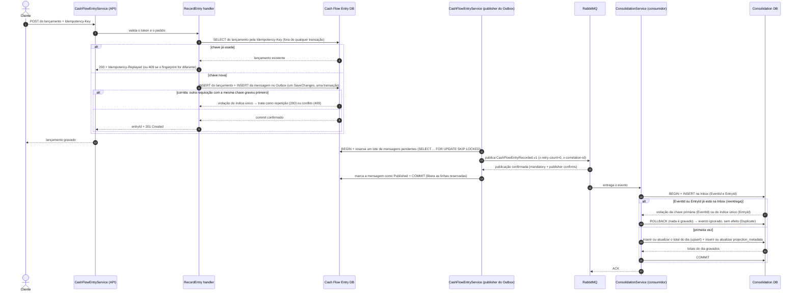

# Diagrama de sequência — registro com Outbox

O fluxo normal, sem falhas, de um lançamento: o cliente registra, Lançamentos grava o lançamento
e a mensagem a publicar na mesma transação (o Outbox), o publisher envia a mensagem ao RabbitMQ, e
o consumidor do Consolidado soma o lançamento aos totais do dia. A resposta ao cliente sai antes
de o Consolidado receber o evento: é por isso que o registro não depende do Consolidado estar no
ar.

Como ler os passos:

- **Repetição e corrida (passos 3 a 9).** A busca pela `Idempotency-Key` acontece **antes** de
  qualquer transação, só para responder rápido a uma repetição. Quem impede o lançamento duplicado
  é o índice único em `idempotency_key`: se duas requisições com a mesma chave chegarem juntas, a
  segunda recebe o erro de violação (código `23505` do PostgreSQL) e é tratada como repetição ou
  conflito. O fingerprint é o resumo do valor, da natureza e da descrição; se ele mudar com a
  mesma chave, a resposta é `409` ([ADR-004](../adr/ADR-004-processamento-idempotente.md)).
- **Publicação (passos 11 a 14).** Cada cópia do publisher reserva um lote de mensagens pendentes
  que nenhuma outra cópia pode pegar ao mesmo tempo. Só marca a mensagem como publicada depois de
  o RabbitMQ confirmar que a recebeu e a entregou a uma fila (`mandatory` e publisher confirms,
  [ADR-003](../adr/ADR-003-transactional-outbox.md)).
- **Consumo (passos 15 a 22).** A Inbox, a tabela dos eventos já aplicados, e os totais do dia
  são gravados na mesma transação. O ACK (acknowledgement, a confirmação de recebimento ao broker)
  só sai depois do commit. Um evento entregue de novo esbarra na chave primária (`event_id`) ou no
  índice único (`entry_id`) da Inbox: a transação é desfeita (`ROLLBACK`), nada é somado, e o ACK
  sai do mesmo jeito, porque o evento já estava aplicado.
