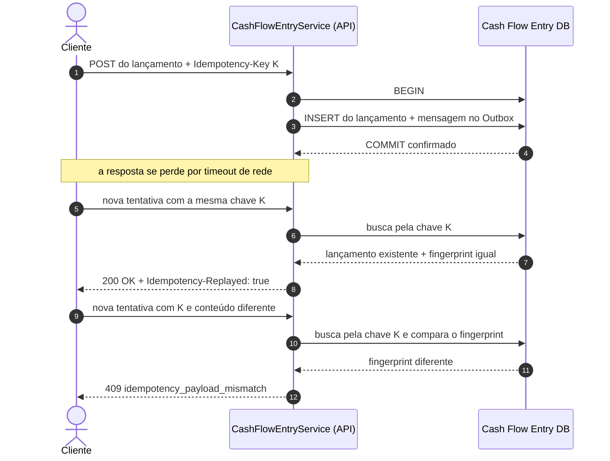

# Diagrama de sequência — timeout e nova tentativa sem duplicar

O cliente registra um lançamento, mas a resposta se perde na rede. Ele tenta de novo com a mesma
`Idempotency-Key` e recebe o lançamento original, sem criar um segundo. Se tentar com a mesma
chave e outro conteúdo, recebe `409`. Exemplo: a chave `venda-0001` foi usada para R$ 100,00 a
crédito; repetir com R$ 100,00 devolve o mesmo lançamento; repetir com R$ 150,00 devolve `409`.

Quem protege contra duas requisições simultâneas com a mesma chave são as restrições do banco —
regras que o próprio PostgreSQL aplica a toda gravação, aqui o índice único em `idempotency_key`.
Uma consulta antes de gravar, sem essa restrição, não bastaria: as duas requisições poderiam
consultar ao mesmo tempo, não encontrar nada e gravar as duas
([ADR-004](../adr/ADR-004-processamento-idempotente.md)).
