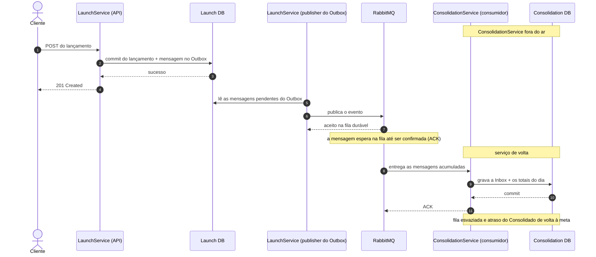

# Diagrama de sequência — Consolidado fora do ar e recuperação

O Consolidado está fora do ar, e um lançamento chega. Lançamentos registra e responde `201`
normalmente; a mensagem é publicada e espera na fila do RabbitMQ. Quando o Consolidado volta, ele
processa as mensagens acumuladas e os totais do dia se atualizam.

Uma falha no consumidor ou no banco do Consolidado nunca desfaz um lançamento já confirmado. Para
acompanhar uma queda, o monitoramento olha a idade da mensagem mais antiga, o tamanho da fila, a
DLQ (Dead Letter Queue, fila das mensagens que não puderam ser processadas) e o atraso
`consumer_lag_seconds` — e não a resposta de uma consulta isolada, que não mostra quantas
mensagens esperam ([ADR-005](../adr/ADR-005-eventual-consistency.md), decisão sobre a consistência
eventual). O que fazer em cada caso está em [`docs/07-runbooks.md` §2](../07-runbooks.md).
