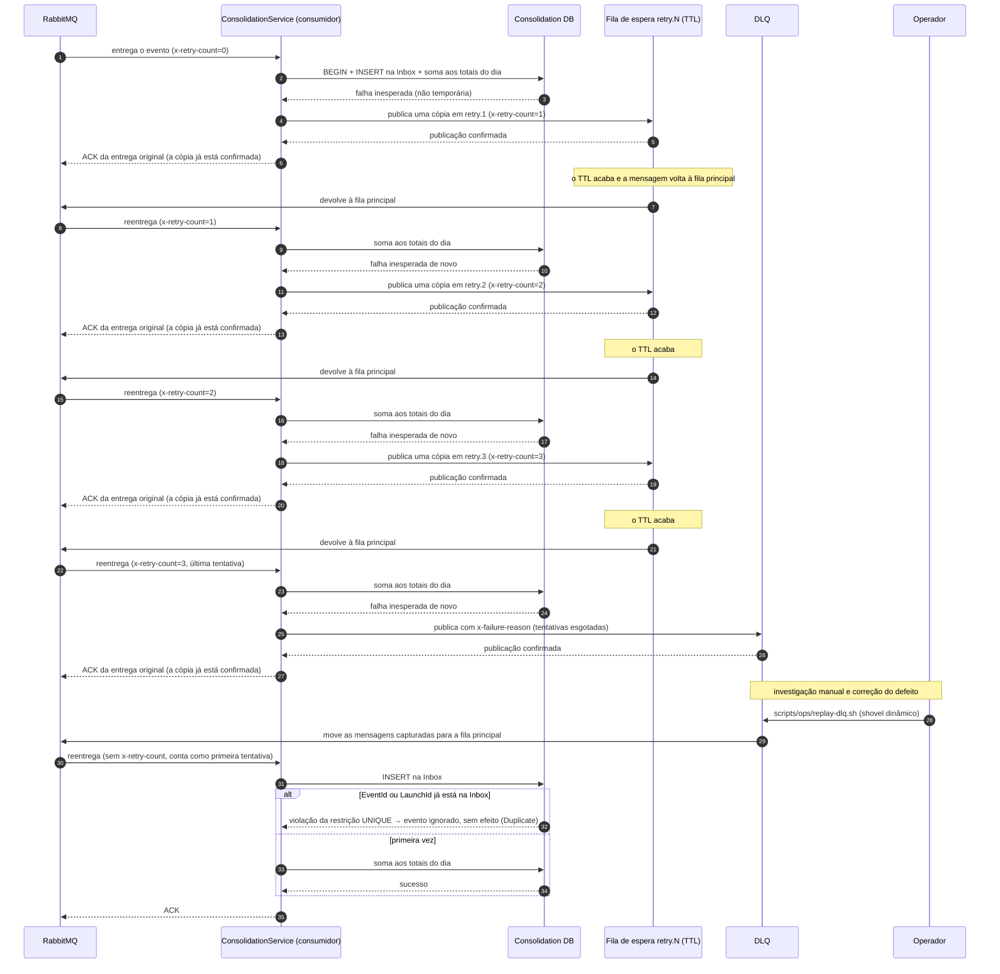

# Diagrama de sequência — falha inesperada no consumidor: filas de espera, DLQ (Dead Letter Queue) e reenvio

Quando o consumidor do Consolidado falha de um jeito inesperado — por exemplo, um defeito no
código —, a mensagem não é perdida nem tentada sem fim. Ela passa por três filas de espera
(`retry.1`, `retry.2` e `retry.3`). Em cada uma, espera um tempo — o TTL (Time To Live, tempo de
vida), de 5 s, 30 s e 120 s — e o RabbitMQ a devolve à fila principal para nova tentativa. Se
falhar nas três, vai para a DLQ, a fila das mensagens que não puderam ser processadas. Depois de
corrigida a causa, um operador a reenvia com `scripts/ops/replay-dlq.sh`.

Três situações chegam a este fluxo, e nenhuma é uma falha temporária — essa nunca vai para a DLQ
([09-sequence-transient-retry.md](09-sequence-transient-retry.md) §1):

- **Falha inesperada** — qualquer erro que o classificador de falhas
  (`ConsumerFailureClassifier.Classify`) não reconhece como temporário (a lista está no
  diagrama 09). Passa por `retry.1`, `retry.2` e `retry.3`, e só então vai para a DLQ. É o fluxo
  desenhado acima.
- **Mensagem inválida** — JSON malformado, ou formato e versão que a validação recusa antes de
  tentar somar. Vai direto para a DLQ, sem passar pelas filas de espera: ela nunca teria sucesso
  numa nova tentativa.
- **Mensagem repetida** — o mesmo `EventId` ou `LaunchId` já está na Inbox. Não é uma falha: o
  consumidor ignora a cópia, confirma (ACK) normalmente e nunca chega às filas de espera.

Cada cópia publicada numa fila de espera ou na DLQ é confirmada pelo broker (publisher confirms)
antes do ACK da entrega original. Se a publicação da cópia falhar, a entrega original é devolvida
à fila (NACK com `requeue: true`, o contrário do ACK) e nunca se perde em silêncio.

O reenvio (`scripts/ops/replay-dlq.sh`) usa um shovel dinâmico, recurso do RabbitMQ que move as
mensagens da DLQ de volta para a fila principal. A Inbox — `EventId` e `LaunchId`,
[ADR-004](../adr/ADR-004-processamento-idempotente.md) — garante que uma mensagem já somada antes
seja ignorada, sem efeito. Uma mensagem permanentemente inválida volta para a DLQ, como na
primeira vez: é o esperado, e não uma falha do reenvio.
