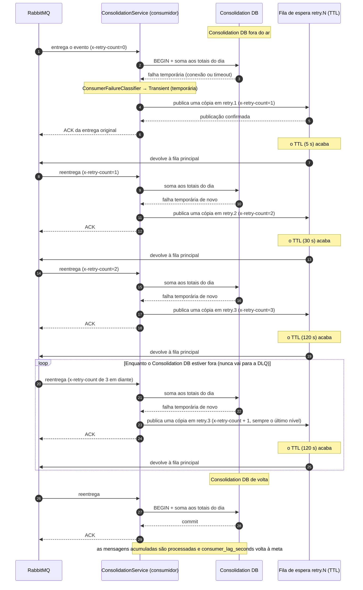
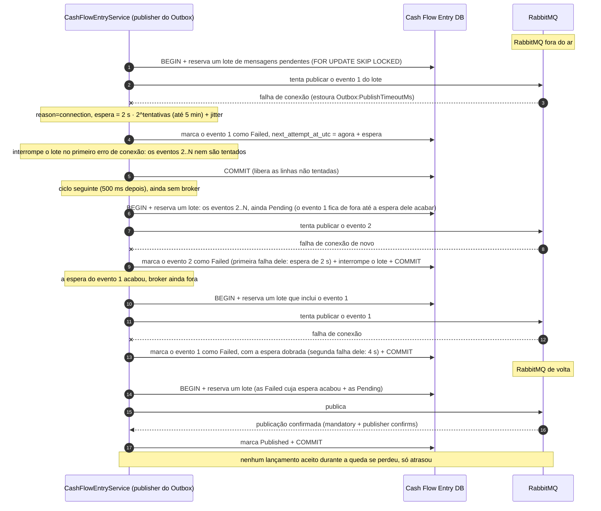

# Diagrama de sequência — falha temporária: o consumidor nunca para e nunca manda à DLQ (Dead Letter Queue)

Dois casos de indisponibilidade que o consumidor e o publisher resolvem sozinhos, sem intervenção
manual e sem perder nenhum evento. Eles são diferentes da falha **inesperada**
([08-sequence-dlq-replay.md](08-sequence-dlq-replay.md)), que tem um número máximo de tentativas
e termina na DLQ, a fila das mensagens que não puderam ser processadas, e do consumidor **parado**
([07-sequence-outage-recovery.md](07-sequence-outage-recovery.md)), quando nenhuma entrega
acontece.

## 1. Banco do Consolidado fora do ar — o consumidor continua ligado e as reentregas continuam

Com o banco do Consolidado (`Consolidation DB`) fora do ar, cada tentativa falha. A mensagem passa
pelas filas de espera — `retry.1`, `retry.2` e `retry.3`, com TTL (Time To Live, o tempo que a
mensagem espera antes de voltar à fila principal) de 5 s, 30 s e 120 s — e, a partir da última,
volta para ela de novo, enquanto a queda durar. Quando o banco volta, a próxima tentativa funciona.

**O que conta como falha temporária.** O classificador de falhas
(`ConsumerFailureClassifier.Classify`) trata como temporária uma falha de infraestrutura que pode
passar sozinha:

- um erro do PostgreSQL de conexão (`SqlState` da classe `08`) ou de falta de recursos (classe
  `53`);
- o servidor desligando ou ainda sem aceitar conexões (`57P01`, `57P02`, `57P03`), uma consulta
  cancelada por tempo (`57014`), uma linha travada por outra transação (`55P03`), um conflito
  entre transações ou um impasse entre elas, o deadlock (`40001`, `40P01`);
- uma exceção que o driver do PostgreSQL (Npgsql) marca como temporária, ou um
  `TimeoutException`, `SocketException` ou `IOException`.

Qualquer outro erro é inesperado e segue o diagrama 08. Uma falha temporária nunca avança para a
DLQ: quando o contador de tentativas (`retryCount`) chega ao último nível (`retry.3`), cada nova
tentativa volta a esse mesmo nível, sem limite, até o banco voltar. É o comportamento decidido no
ADR-002 (decisão sobre a integração assíncrona, seção "Failure modes") e detalhado no ADR-011
(decisão sobre a topologia de processos, seção "Decisão"), e não um defeito.

## 2. Broker fora do ar — o Outbox espera cada vez mais e interrompe o lote

Com o RabbitMQ fora do ar, o publisher do Outbox não consegue publicar. Na primeira falha de
conexão, ele marca aquela mensagem para tentar mais tarde e interrompe o lote: as outras mensagens
reservadas nem são tentadas, porque também falhariam. A espera entre as tentativas dobra a cada
vez que a mesma mensagem falha (backoff), com um tempo aleatório somado (jitter), para que as
mensagens não tentem todas no mesmo instante. Cada mensagem tem a própria espera: uma que nunca foi
tentada continua `Pending` e entra no ciclo seguinte.

Lançamentos nunca deixa de aceitar registros durante a queda do broker (NFR-001, requisito: o
Consolidado fora do ar não derruba Lançamentos; o ADR-002 estende a garantia ao broker). O
publisher do Outbox é uma tarefa em segundo plano (`BackgroundService`), separada do caminho das
requisições HTTP: o `POST /entries` continua respondendo `201` normalmente, e só a publicação
fica para depois.
